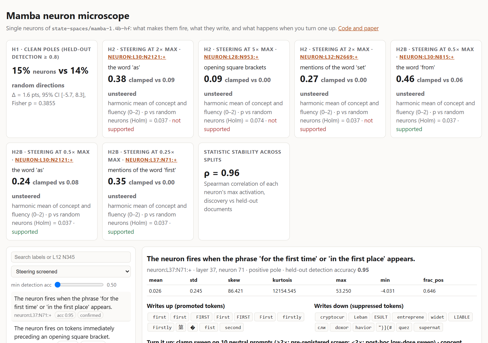
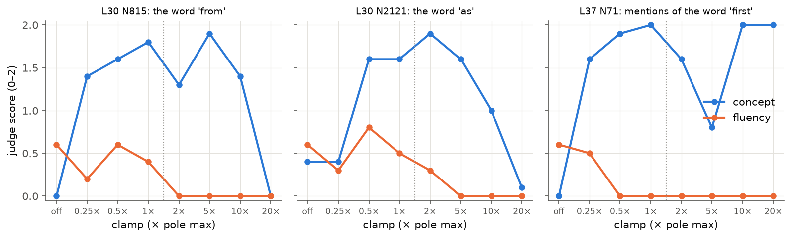
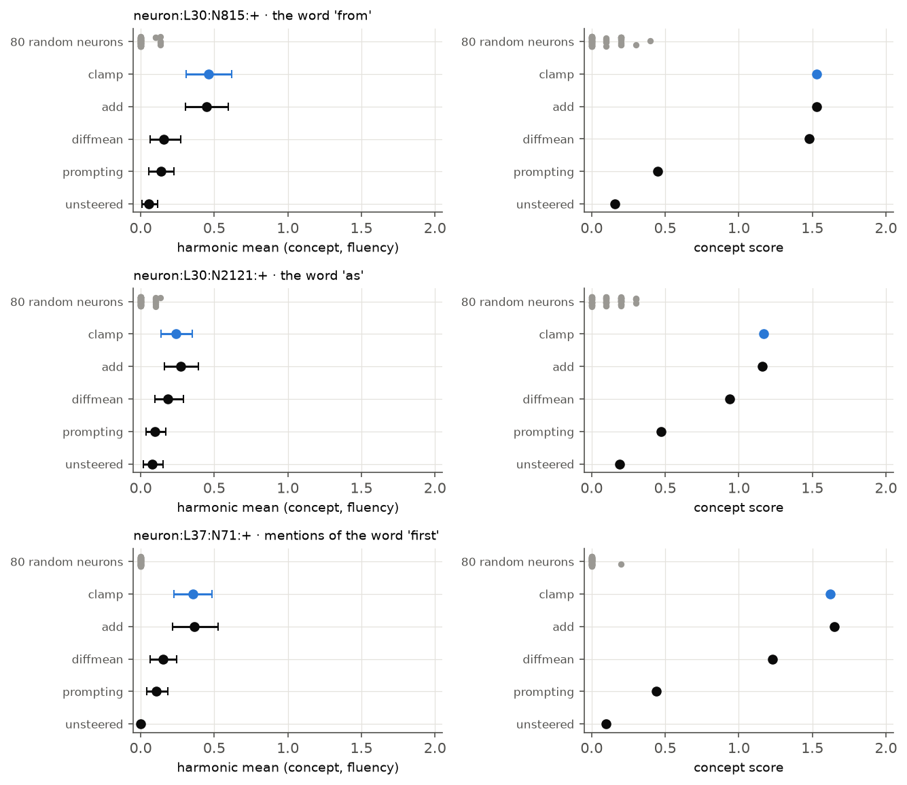
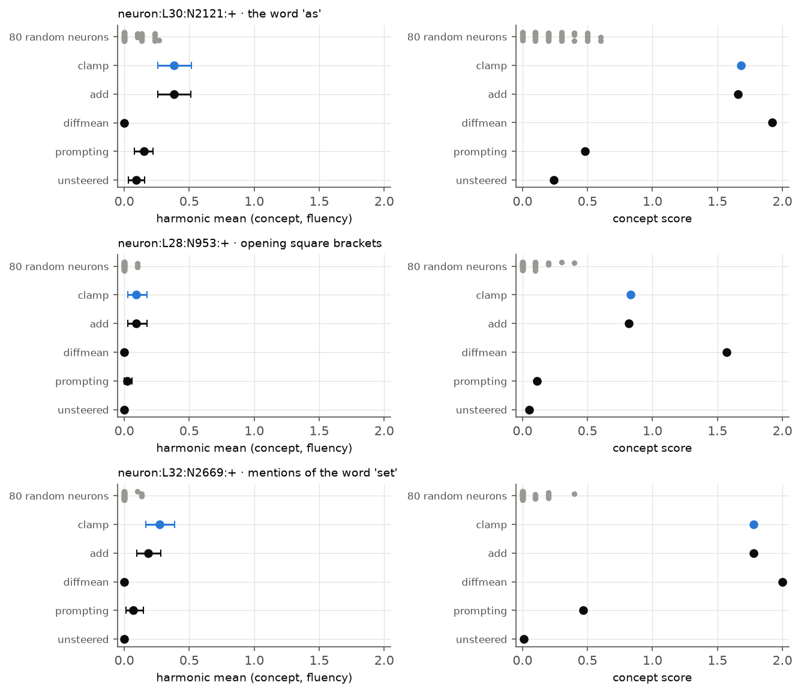
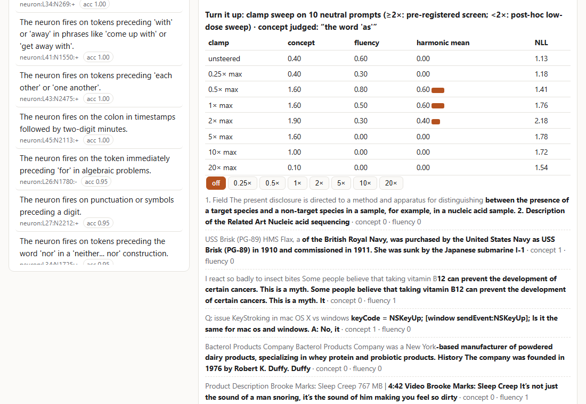
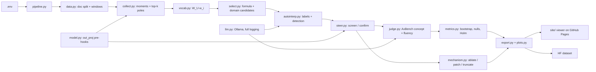

# Mamba neuron microscope

Neuron-level mechanistic interpretability of the **Mamba-1.4B** state-space language model ([Gu & Dao 2023](https://arxiv.org/abs/2312.00752)). It covers all **196,608 neurons**, following the workflow of Goodfire's [*Neural Networks Are Already Clean*](https://already-clean.goodfire.com/):

1. Look at each neuron's positive and negative poles and its strongest firings.
2. See what it writes into the vocabulary.
3. Label it with an LLM and test the label on held-out text.
4. Audit how many neurons are clean.
5. Turn single neurons up during generation, compared against random-neuron, DiffMean and prompting baselines.

All confirmatory tests are pre-registered ([reports/preregistration.md](reports/preregistration.md), 7 dated amendments); post-hoc analyses are labelled as such. Everything runs locally on an 8 GB laptop GPU, with a local LLM (Qwen3.5-9B via Ollama) as labeller and judge.

**Interactive viewer:** https://burnycoder.github.io/mamba-neuron-mechanistic-interpretability/ · **Dataset:** [BurnyCoder/mamba-1.4b-neuron-atlas](https://huggingface.co/datasets/BurnyCoder/mamba-1.4b-neuron-atlas) ([collection](https://huggingface.co/collections/BurnyCoder/mamba-neuron-interpretability-6ae23bf88df873e27b8320a2)) · **Paper:** [reports/paper.pdf](reports/paper.pdf)





## Highlights
- **Every neuron is a sparse detector.** The median Mamba neuron has activation kurtosis **354**; random directions in the same space have 6.9. 86% of neurons are positively skewed, i.e. they fire mainly on their positive pole. The statistics replicate on disjoint documents (Spearman ρ 0.94–0.999). [Report 1](reports/experiment_01_atlas.md)
- **Negative: a local-LLM audit cannot tell neurons from random directions.** 15.1% of random neuron poles are "clean" (held-out detection accuracy ≥ 0.8), against 13.5% of random directions. Fisher p = 0.39, so pre-registered H1 is **not supported**. The instrument is weak (detection-judge κ = 0.55), so this is not evidence against clean neurons. [Report 2](reports/experiment_02_autointerp_h1.md)
- **Positive: clearly interpretable neurons exist.** The pre-registered selection formula finds neurons a 9B model can describe and predict on held-out text (30 of 60 clean, mean accuracy 0.77):
  - L37 N1812 fires on "after" in *after all* and writes `all`.
  - L34 N1725 fires on *neither … nor*.
  - L38 N918 fires on *make(s)* before *sense*.
  - L43 N2475 fires before *each other*.
  - L36 N109 fires inside email addresses.
- **Positive: turning one neuron up injects its concept, specifically.**
  - In the pre-registered H2 confirmation on 50 fresh prompts × 2 seeds, clamping raised the concept score above **all 80 random same-layer neurons** clamped at the same relative dose, for all 3 neurons (p = 1/81).
  - It also beat prompting on the primary metric.
  - Best neuron: **L30 N2121, the "as" neuron**: "…let your children know you are **as** proud of them **as** they are…" [Report 3](reports/experiment_03_steering_h2.md)
- **Negative: at the pre-registered doses (≥ 2× the neuron's maximum), text degenerates.** "all all all …", "@@@@". **H2 is not supported**, because the absolute fluency criterion fails. DiffMean at the same norm degenerates even more (distinct-2 0.03–0.17).
- **Post hoc → re-tested: gentle doses (0.25–0.5× max) steer fluently.** Concept 0.08 → 0.52 at 0.25× while distinct-2 stays at 0.83 (unsteered 0.91). **Pre-registered H2b on 50 fresh prompts × 2 seeds: supported for all 3 neurons.** The "from", "as" and "first" neurons each beat all 80 random neurons (Holm p = 0.037), beat prompting and DiffMean, and keep fluency non-inferior to unsteered text. Example: "…have been recognized as the **first** step in understanding the biomechanical behavior of the bone…"
- **Mamba-specific mechanism: mid and late neurons run on SSM memory, not the convolution.**
  - With only the 4-token convolution window, neurons from layer 20 on keep just 10–24% (median) of their activation. Early-layer detectors keep 92%.
  - The gate `SiLU(z)` is always open at firings, so the SSM factor decides the pole.
  - Necessity is weak: zero-ablation costs only 0.002–0.012 nats where they fire. [Report 4](reports/experiment_04_mechanism_h3.md)

## What a "neuron" is in Mamba
```
x, z = in_proj(RMSNorm(h)).chunk(2)          # two 4096-wide branches
x̃    = SiLU(conv1d(x))                       # causal conv, kernel 4
a    = (SelectiveSSM(x̃) + D ⊙ x̃) ⊙ SiLU(z)   # gated SSM output  <- neurons a_i
h'   = h + out_proj(a)                         # write vector of neuron i = column i of out_proj
```
Neuron (ℓ, i) is `a_i`, the input to `mixer.out_proj` (HF [`modeling_mamba.py`](https://github.com/huggingface/transformers/blob/main/src/transformers/models/mamba/modeling_mamba.py)). It's the analogue of the SwiGLU neuron `SiLU(W_g x) ⊙ (W_u x)` that Goodfire studies in Qwen3 ([Shazeer 2020](https://arxiv.org/abs/2002.05202)):
- Each neuron has its own write vector.
- An elementwise gate acts on it, which makes the basis privileged.
- Its two factors are signed, so each neuron has a positive and a negative pole.

Unit tests prove the hook site. `out_proj(a)` equals the mixer output, and adding δ to `a_i` is identical to adding δ·`w_i` to the residual stream. Details are in [docs/methodology.md](docs/methodology.md).

## Method in one table
| Step | What | Data | Grounded in |
|---|---|---|---|
| Atlas | Moments, max/min, top-40 firings per pole, for all neurons and 96 random directions | 2.32M discovery tokens and 0.65M held-out tokens of [pile-10k](https://huggingface.co/datasets/NeelNanda/pile-10k), split by document | [Neuroscope](https://neuroscope.io/), [Bills et al. 2023](https://openaipublic.blob.core.windows.net/neuron-explainer/paper/index.html) |
| Writes | Vocab projection `W_U(g ⊙ w_i)`, vocab kurtosis | weights | [Geva et al. 2022](https://arxiv.org/abs/2203.14680), [Gurnee et al. 2024](https://arxiv.org/abs/2401.12181) |
| Candidates | Pre-registered rank formula (60 poles) plus domain-selective neurons (24) | discovery | — |
| Labels | Local LLM explanation, scored by held-out detection (balanced accuracy) | held-out | [delphi / Paulo et al. 2024](https://arxiv.org/abs/2410.13928) |
| H1 | Clean-pole rate: random neurons vs random directions | 192 + 192 poles | privileged basis ([Elhage et al. 2022](https://transformer-circuits.pub/2022/toy_model/index.html)) |
| Screen | Clamp at 2/5/10/20× pole max on 10 prompts; AxBench concept and fluency judge | prompt set A | [AxBench](https://arxiv.org/abs/2501.17148), [Templeton et al. 2024](https://transformer-circuits.pub/2024/scaling-monosemanticity/) |
| H2 | Confirmation on 50 fresh prompts × 2 seeds against unsteered, random-neuron null (80), DiffMean, additive steering and prompting | prompt set B | AxBench, [ActAdd](https://arxiv.org/abs/2308.10248) |
| H2b | Post-hoc low-dose sweep (0.25/0.5/1×), then the same confirmation at gentle doses with a non-inferior-fluency rule | sets A → C | pre-registered after the sweep (amendment 7) |
| H3 / mechanism | Zero-ablation against 20 random neurons, gate vs SSM factor, context truncation, activation patching | held-out | [Meng et al. 2022](https://arxiv.org/abs/2202.05262) |

## Results
**Steering confirmations.** HM = harmonic mean of the LLM judge's concept and fluency scores (0–2), averaged over 100 generations, with 95% prompt-cluster-bootstrap CIs. The null is 80 random same-layer neurons at the same relative clamp.

| Neuron · concept · dose | Unsteered | **Neuron clamp** | Neuron add | DiffMean (same norm) | Prompting | Random-neuron null (mean / max) | Holm p vs null | Verdict |
|---|---|---|---|---|---|---|---|---|
| L30 N2121 · "as" · 2× (H2) | 0.09 | **0.38** [0.26, 0.52] | 0.38 | 0.00 | 0.15 | 0.05 / 0.27 | **0.037** | fluency rule fails |
| L28 N953 · "[" · 5× (H2) | 0.00 | 0.09 [0.03, 0.17] | 0.09 | 0.00 | 0.02 | 0.01 / 0.10 | 0.074 | not significant |
| L32 N2669 · "set" · 2× (H2) | 0.00 | **0.27** [0.17, 0.39] | 0.18 | 0.00 | 0.07 | 0.01 / 0.13 | **0.037** | fluency rule fails |
| **L30 N815 · "from" · 0.5× (H2b)** | 0.06 | **0.46** [0.31, 0.62] | 0.45 | 0.16 | 0.14 | 0.01 / 0.13 | **0.037** | **supported** (fluency 0.45 vs 0.48, distinct-2 0.90 vs 0.93) |
| **L30 N2121 · "as" · 0.5× (H2b)** | 0.08 | **0.24** [0.14, 0.35] | 0.27 | 0.19 | 0.10 | 0.01 / 0.13 | **0.037** | **supported** (0.32 vs 0.41; 0.92 vs 0.93) |
| **L37 N71 · "first" · 0.25× (H2b)** | 0.00 | **0.35** [0.23, 0.49] | 0.36 | 0.15 | 0.11 | 0.00 / 0.00 | **0.037** | **supported** (0.42 vs 0.42; 0.87 vs 0.93) |

**In plain language:**
- **Better than every control.** Clamping one of these neurons makes the model use its word or concept far more than unsteered text, more than prompting with the concept, and more than any of 80 random neurons pushed equally hard.
- **Worse at preserving text quality.** At the pre-registered doses the text gets repetitive, so judged fluency falls below unsteered text.
- **DiffMean is the worst baseline here.** At the same budget it simply repeats the word.

| Other tests | Result |
|---|---|
| H1: clean poles, random neurons vs random directions | 15.1% vs 13.5%, Δ +1.6 pts [−5.7, +8.3], p = 0.39 → not supported |
| H3: zero-ablation drop at top firings (nats) vs 20 random neurons | "as" −0.003 (p 0.76) · "[" 0.0018 (p 0.048) · "set" 0.012 (p 0.048) |
| Activation kept with the 4-token conv window only (median by layer) | layers 0–1: 0.92 · 20–29: 0.10 · 30–39: 0.18 · 40–47: 0.24 |
| Judge validity vs blind ratings (κ) | detection 0.55 · steering concept 0.79 · steering fluency 0.34 |







Per-experiment reports with all learnings are in [reports/](reports/); [reports/all_experiments.md](reports/all_experiments.md) is the summary.

## How the pipeline flows

Phase by phase, with the files each one reads and writes: [docs/pipeline.md](docs/pipeline.md). Running the pipeline does the following:
1. Tokenizes the Pile sample.
2. Streams it through Mamba with hooks on all 48 `out_proj` inputs (about 1 hour).
3. Ranks neurons.
4. Rebuilds highlighted examples.
5. Asks the local LLM to label and score each pole (about 30 minutes).
6. Steers the model with clamped neurons and asks the LLM to judge the outputs (a few hours).
7. Writes JSON results, figures and the viewer data.

## Setup
Requirements: an NVIDIA GPU with at least 8 GB (tested on an RTX 5070 Laptop GPU, Windows 11), [uv](https://docs.astral.sh/uv/), [Ollama](https://ollama.com/), and about 15 GB of disk.
```bash
git clone https://github.com/BurnyCoder/mamba-neuron-mechanistic-interpretability
```
```bash
cd mamba-neuron-mechanistic-interpretability
```
```bash
uv sync
```
```bash
cp .env.example .env
```
```bash
ollama pull qwen3.5:9b
```
In `.env`, set `OUTPUT_DIR` and `HF_HOME` to a disk with space, and `HF_TOKEN_PATH` to your token if you'll upload. PyTorch comes from the CUDA 13.0 wheel index (see `pyproject.toml`).

## Usage
```bash
uv run pytest
```
```bash
uv run python -m mamba_neurons.pipeline --phases all
```
```bash
uv run python -m http.server 8000 --directory site
```
- **Pipeline stages.** The pre-registered flow stops after `screen_judge`, so the confirmation plan can be frozen in the pre-registration before `confirm` runs; see [docs/reproducibility.md](docs/reproducibility.md).
- **Logging.** Each run writes `logs/<timestamp>_<phases>.log` and streams it to the terminal. Every LLM prompt and reply is logged in full to `logs/*_llm_calls.jsonl`. The complete logs of the reported runs are archived (gzipped) in [reports/logs/](reports/logs/).
- **`all` and uploads.** `--phases all` runs every analysis phase but not the Hugging Face upload; run `--phases hf` explicitly to publish.
- **Viewer.** The `http.server` command serves the viewer locally ([docs/viewer.md](docs/viewer.md)).
- **Quick smoke test.** Use the 130M model:
  ```bash
  uv run python -m mamba_neurons.pipeline --model state-spaces/mamba-130m-hf --phases collect,vocab,select
  ```
  Set small `MAX_*_TOKENS` and a separate `OUTPUT_DIR` first.

## Features
- Hook-based neuron recording and editing for HF Mamba (clamp, add, residual vectors, single-site patching), all unit-tested.
- A streaming atlas of every neuron: moments, both poles, top-k firings, random-direction controls, split stability.
- Write-side analysis: vocab projection and prediction/suppression kurtosis.
- Two candidate streams: a pre-registered formula and domain-selective neurons.
- Local-LLM auto-interpretation: delphi-style explanation plus held-out detection scoring, resumable, fully logged.
- Steering evaluation: AxBench judge, a random-neuron null, DiffMean, additive and prompting baselines, cluster bootstrap and Holm correction.
- Mechanism tools: ablation, gate-vs-SSM factor split (the double-negative regime), context truncation (conv window vs SSM memory), activation patching.
- Judge validation against blind ratings (Cohen's κ).
- A static, deep-linkable neuron viewer (GitHub Pages) and a Hugging Face dataset export.

## Technologies
PyTorch 2.14 (CUDA 13.0), Hugging Face `transformers` 5.21 (`MambaForCausalLM`, torch scan path), `datasets`, `huggingface_hub`, Ollama 0.40 + Qwen3.5-9B, NumPy/SciPy/statsmodels/pandas, matplotlib, Playwright (screenshots), uv, pytest, and GitHub Actions/Pages.

## Repository map
`src/mamba_neurons/` holds the library and `phases/`. `tests/` has the pytest suite. `scripts/` has the labeller comparison, judge validation and screenshots. `site/` is the viewer. `docs/` holds methodology, pipeline, viewer and reproducibility. `reports/` has the pre-registration, experiment reports and paper. `results/` holds the small JSON results and figures.

## License
MIT for the code. Model and data keep their own licences: [mamba-1.4b-hf](https://huggingface.co/state-spaces/mamba-1.4b-hf) and [the Pile](https://pile.eleuther.ai/).
