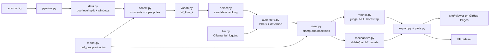

# Mamba neuron microscope

Neuron-level mechanistic interpretability of the **Mamba-1.4B** state-space language model. It finds, labels, audits and **steers single neurons**, following the workflow of Goodfire's [*Neural Networks Are Already Clean*](https://already-clean.goodfire.com/):

1. Look at each neuron's positive and negative poles and its strongest firings.
2. See what it reads from and writes to.
3. Label it.
4. Audit how many neurons are clean.
5. Turn a neuron up and read what the model writes.

> **Status:** pipeline under construction. Results, figures and the viewer link will be added here as each experiment finishes. The analysis plan is pre-registered in [reports/preregistration.md](reports/preregistration.md).

## What a "neuron" is in Mamba
A Mamba block ([Gu & Dao 2023](https://arxiv.org/abs/2312.00752)) computes:

```
x, z = in_proj(RMSNorm(h)).chunk(2)          # two d_inner-wide branches
x̃    = SiLU(conv1d(x))                       # short causal convolution (kernel 4)
a    = (SelectiveSSM(x̃) + D ⊙ x̃) ⊙ SiLU(z)   # gated SSM output  <- the neurons
h'   = h + out_proj(a)                         # write back into the residual stream
```

**Neuron (ℓ, i)** is coordinate `a_i` of block ℓ. Mamba-1.4B has 48 × 4096 = 196,608 of them.

This is the direct analogue of a SwiGLU MLP neuron `SiLU(W_g x) ⊙ (W_u x)` feeding `down_proj` ([Shazeer 2020](https://arxiv.org/abs/2002.05202)), which is the unit Goodfire studies in Qwen3:
- Each neuron has its own write vector, column i of `out_proj.weight`.
- An elementwise gate acts on it, which makes the basis privileged.
- Both factors are signed, so each neuron has a positive and a negative pole.

## Method (pre-registered)
| Phase | What happens | Grounded in |
|---|---|---|
| Collect | Stream about 3M Pile tokens through the model. Per neuron, keep moments, max and min, and the top-20 firings of each pole. 96 random directions serve as controls. | [Neuroscope](https://neuroscope.io/), [Bills et al. 2023](https://openaipublic.blob.core.windows.net/neuron-explainer/paper/index.html) |
| Vocab | Project each write vector through the unembedding, `W_U(g ⊙ w_i)`, to get promoted and suppressed tokens, plus vocab kurtosis. | [Geva et al. 2022](https://arxiv.org/abs/2203.14680), [Gurnee et al. 2024](https://arxiv.org/abs/2401.12181) |
| Select | Rank poles by a fixed formula: activation kurtosis, vocab kurtosis, input-output coherence. | pre-registered |
| Auto-interp | A local LLM (Qwen3.5-4B via Ollama) labels each pole. Labels are scored by held-out detection accuracy, for neurons against random directions (H1). | [Paulo et al. 2024 / delphi](https://github.com/EleutherAI/delphi) |
| Steer | Clamp or add to a single neuron during generation. Compared against unsteered output, random-neuron nulls, DiffMean and prompting (H2). | [AxBench](https://arxiv.org/abs/2501.17148), [ActAdd](https://arxiv.org/abs/2308.10248), [Templeton et al. 2024](https://transformer-circuits.pub/2024/scaling-monosemanticity/) |
| Mechanism | Ablation against random neurons (H3), activation patching, gate-vs-SSM factor split, context truncation. | [Meng et al. 2022](https://arxiv.org/abs/2202.05262), [Sharma et al. 2024](https://arxiv.org/abs/2404.03646) |

## Architecture of the code


## Setup
Requirements: Windows or Linux, an NVIDIA GPU with at least 6 GB (tested on an RTX 5070 Laptop GPU, 8 GB), [uv](https://docs.astral.sh/uv/) and [Ollama](https://ollama.com/).

```bash
git clone https://github.com/BurnyCoder/mamba-neuron-mechanistic-interpretability
```
```bash
cd mamba-neuron-mechanistic-interpretability
```
```bash
uv sync
```
```bash
cp .env.example .env
```
```bash
ollama pull qwen3.5:4b
```

Edit `.env` to change the model, token budgets, paths (big caches default to `D:/AI/...`) or the LLM. PyTorch comes from the CUDA 13.0 wheel index (see `pyproject.toml`).

## Usage
Run the tests:
```bash
uv run pytest
```
Run the whole pipeline:
```bash
uv run python -m mamba_neurons.pipeline --phases all
```
Every run writes a timestamped log to `logs/` and to the terminal. Every LLM prompt and response is logged in full to `logs/*_llm_calls.jsonl`.

## Technologies
PyTorch 2.14 (CUDA 13.0), Hugging Face `transformers` 5.21 (`MambaForCausalLM`, torch scan path), `datasets`, Ollama + Qwen3.5-4B, NumPy/SciPy/statsmodels, matplotlib, uv, and GitHub Pages.

## License
MIT for the code. Model and data licences are those of [state-spaces/mamba-1.4b-hf](https://huggingface.co/state-spaces/mamba-1.4b-hf) and [the Pile](https://pile.eleuther.ai/).
