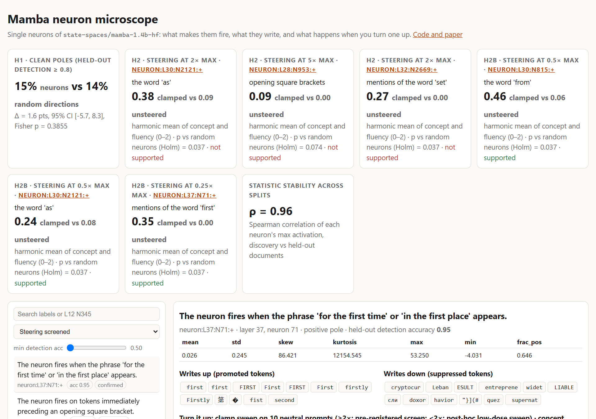
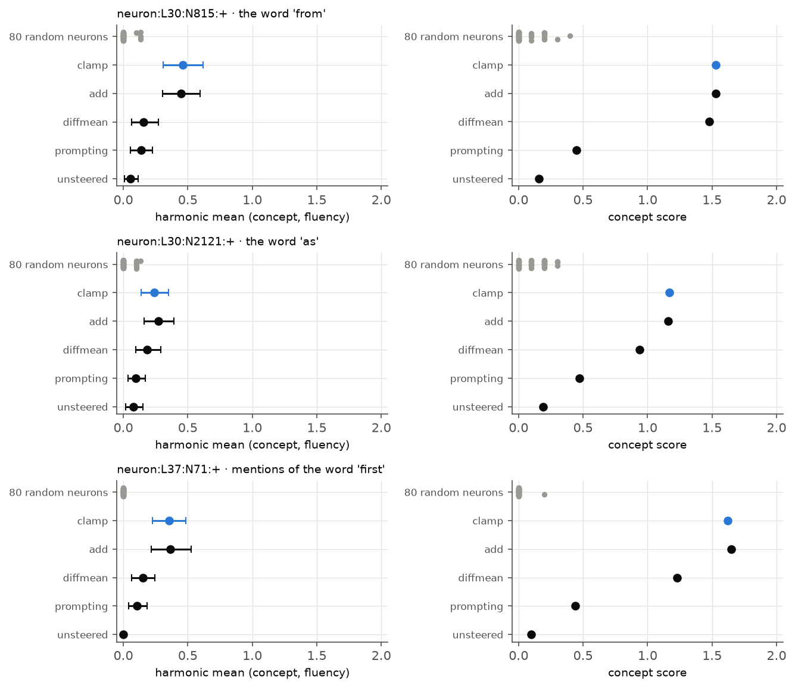
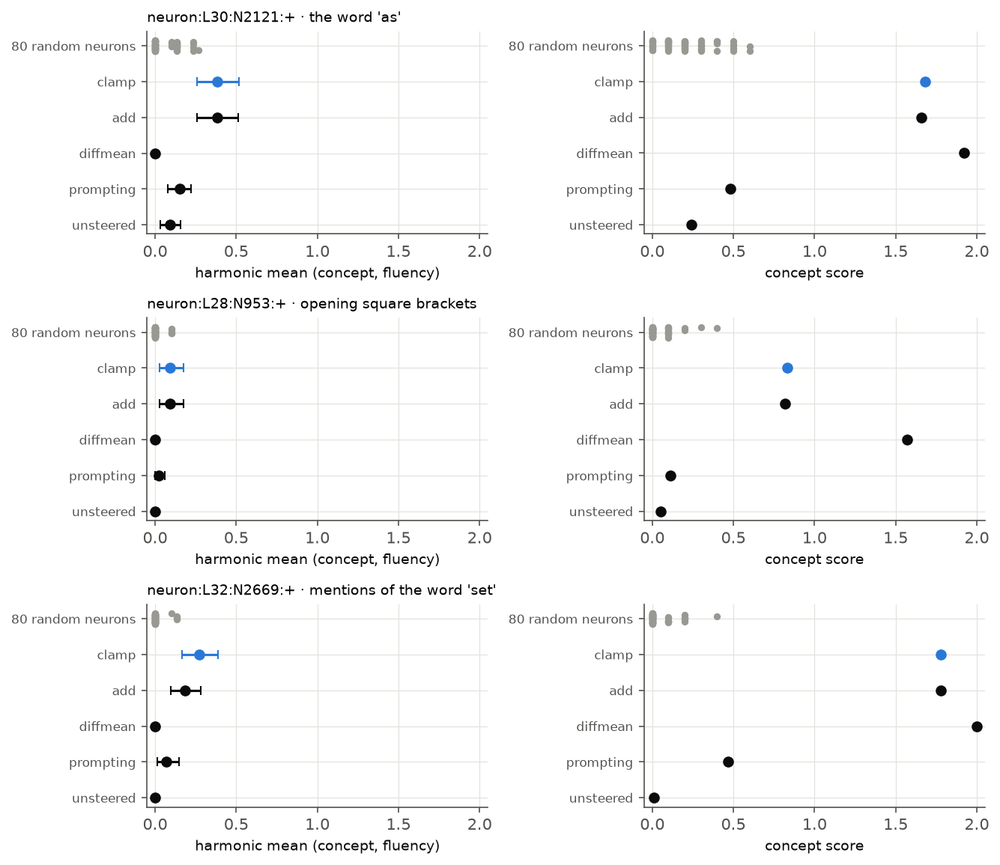
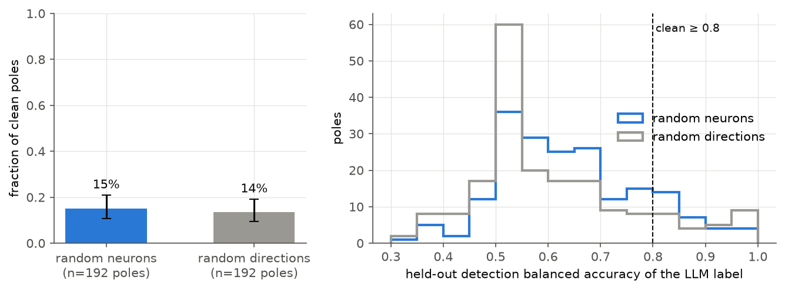
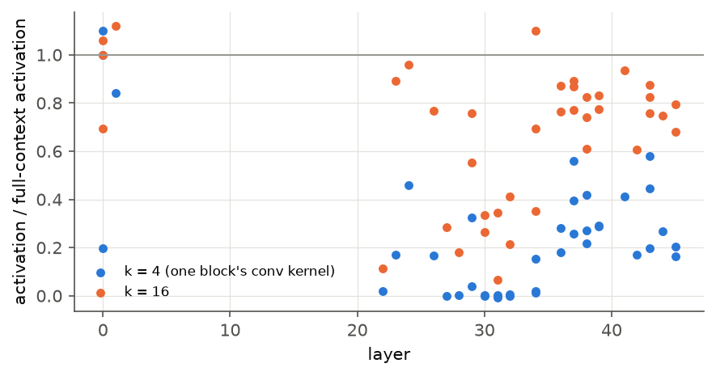
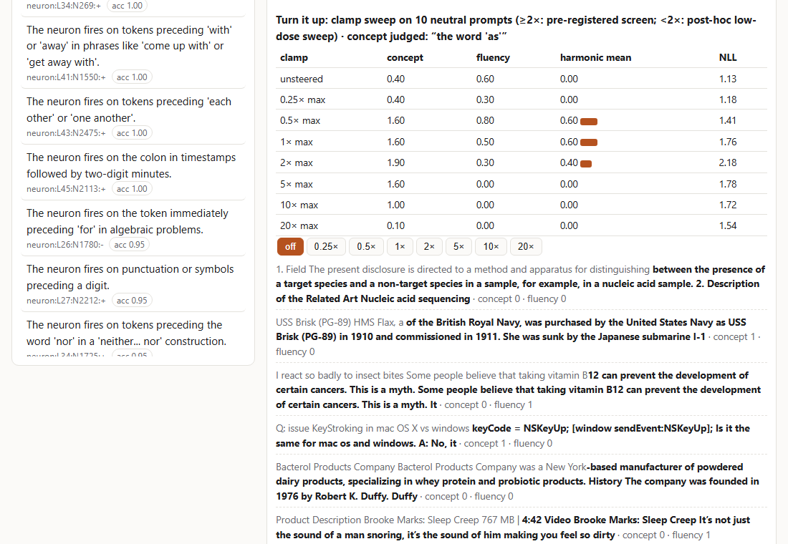
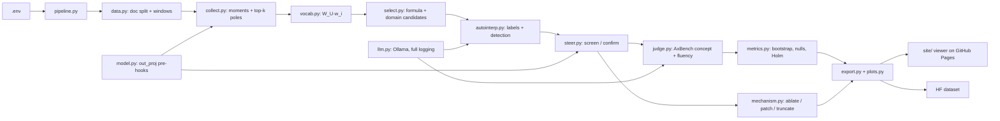

# Mamba neuron microscope

Neuron-level mechanistic interpretability of the **Mamba-1.4B** state-space language model ([Gu & Dao 2023](https://arxiv.org/abs/2312.00752)). It covers all **196,608 neurons**, following the workflow of Goodfire's [*Neural Networks Are Already Clean*](https://already-clean.goodfire.com/):

1. Look at each neuron's positive and negative poles and its strongest firings.
2. See what it writes into the vocabulary.
3. Label it with an LLM and test the label on held-out text.
4. Audit how many neurons are clean.
5. Turn single neurons up during generation, compared against random-neuron, DiffMean and prompting baselines.

All confirmatory tests are pre-registered ([reports/preregistration.md](reports/preregistration.md), 9 dated amendments; the 8th is an audit erratum and the 9th declares a deviation in the judge-validation rater and adds post-hoc analyses); post-hoc analyses are labelled as such. Everything runs locally on an 8 GB laptop GPU, with a local LLM (Qwen3.5-9B via Ollama) as labeller and judge.

**Interactive viewer:** https://burnycoder.github.io/mamba-neuron-mechanistic-interpretability/ · **Dataset:** [BurnyCoder/mamba-1.4b-neuron-atlas](https://huggingface.co/datasets/BurnyCoder/mamba-1.4b-neuron-atlas) ([collection](https://huggingface.co/collections/BurnyCoder/mamba-neuron-interpretability-6ae23bf88df873e27b8320a2)) · **Paper:** [reports/paper.pdf](reports/paper.pdf)




## Highlights
- **Almost all neurons are sparse detectors.** The median Mamba neuron has activation kurtosis **354**, and 90% are above 46. Random directions in the same space have a median of 6.9 (a Gaussian has 3). 86% of neurons are positively skewed: their rare large activations are mostly positive. The statistics replicate on disjoint documents (Spearman ρ 0.94–0.999). [Report 1](reports/experiment_01_atlas.md)
- **Negative/inconclusive: the pre-registered local-LLM audit does not separate neurons from random directions.**
  - 15.1% of random neuron poles are "clean" (held-out detection accuracy ≥ 0.8), against 13.5% of random directions. Fisher p = 0.39, so pre-registered H1 is **not supported**.
  - Post hoc, mean detection accuracy is slightly higher for neurons: +0.034 [0.003, 0.065].
  - The instrument is weak. The detection judge vs reference ratings made by Claude Code gives κ = 0.55 [0.22, 0.82], below the pre-registered bar, so this null says little about whether neurons are clean. [Report 2](reports/experiment_02_autointerp_h1.md)
- **Positive: clearly interpretable neurons exist.** The pre-registered selection formula finds neurons a 9B model can describe and predict on held-out text (30 of 60 clean, mean accuracy 0.77):
  - L37 N1812 fires on the token before *all* (*after all*, *at all*, *of all*) and writes `all`.
  - L34 N1725 fires before *nor* in *neither … nor*.
  - L38 N918 fires on *make(s)* before *sense*.
  - L43 N2475 fires before *each other*.
  - L36 N109 fires inside email addresses.
- **Positive: turning one neuron up injects its concept, specifically.**
  - In the pre-registered H2 confirmation on 50 fresh prompts (47 for "set") × 2 seeds, clamping raised the concept score above **all 80 random same-layer neurons** clamped at the same relative dose, for all 3 neurons (p = 1/81, Holm 0.037).
  - On the primary metric it also beat prompting for "as" and "set" (post-hoc paired CI excludes 0). For "[" the difference is +0.07 [−0.01, +0.16].
  - Best neuron: **L30 N2121, the "as" neuron**: "…let your children know you are **as** proud of them **as** they are…" [Report 3](reports/experiment_03_steering_h2.md)
- **Negative: at the pre-registered doses (≥ 2× the neuron's maximum), text degenerates.** "all all all …", "@@@@". **H2 is not supported**, because the absolute fluency criterion fails. DiffMean at the same norm degenerates even more (distinct-2 0.03–0.17).
- **Post hoc → re-tested: lower doses (0.25–0.5× max) steer with much less damage.** These doses are still several times a neuron's typical strong firing, applied at every token.
  - Averaged over the 39 screened poles at 0.25×, concept rises 0.08 → 0.52, while distinct-2 is 0.83 (unsteered 0.91) and judged fluency 0.42 (unsteered 0.60).
  - **Pre-registered H2b on 50 fresh prompts × 2 seeds: supported for all 3 neurons by its pre-registered rule.** The "from", "as" and "first" neurons each beat all 80 random neurons (Holm p = 0.037).
  - A judge-free count of the target word confirms the effect: 1.0–2.3 per 40 tokens vs 0.04–0.10 unsteered and ≤ 0.30 for every random neuron.
  - The fluency rule was met on point estimates, but fluency preservation is **not established**. The same margins tested on CIs pass for only "from" (exactly at the margin), the fluency judge is unreliable on fluent text, and continuation NLL rises by 0.28–0.51 nats/token.
  - Their harmonic mean is also higher than a bare concept-prefix prompt and DiffMean at the same norm (neither tuned). In a post-hoc paired test, every comparison survives Holm correction except "as" vs DiffMean (+0.05 [−0.06, +0.17]).
  - Example: "…have been recognized as the **first** step in understanding the biomechanical behavior of the bone…"
- **Mechanism (exploratory): deeper neurons need longer inputs.**
  - With only the last 4 tokens of context, the 35 screened poles from layer 22 on keep a median of 10–24% of their activation, depending on the layer bin. The 4 poles in layers 0–1 keep a median of 92%, although one of them (L0 N2107) keeps only 20%.
  - This shows that these neurons need more than 4 tokens of input. It does not separate missing context from the short input itself, and no screened pole lies in layers 2–21. It also does not show whether the context arrives through the SSM state or through convolutions stacked across layers: a layer-ℓ neuron can see 3ℓ+4 tokens through convolutions alone.
  - For the 3 H2 neurons, the gate `SiLU(z)` was open at all 600 examined firings, so the sign of these firings comes from the SSM factor. Because SiLU ≥ −0.28, that is nearly forced at strong firings. Which factor makes a neuron selective was not tested.
  - Necessity is weak: zero-ablation changes log p(next token) by only −0.003 to 0.012 nats where they fire. [Report 4](reports/experiment_04_mechanism_h3.md)

## What a "neuron" is in Mamba
```
x, z = in_proj(RMSNorm(h)).chunk(2)          # two 4096-wide branches
x̃    = SiLU(conv1d(x))                       # causal conv, kernel 4
a    = (SelectiveSSM(x̃) + D ⊙ x̃) ⊙ SiLU(z)   # gated SSM output  <- neurons a_i
h'   = h + out_proj(a)                         # write vector of neuron i = column i of out_proj
```
Neuron (ℓ, i) is `a_i`, the input to `mixer.out_proj` (HF [`modeling_mamba.py`](https://github.com/huggingface/transformers/blob/main/src/transformers/models/mamba/modeling_mamba.py)). It's the analogue of the SwiGLU neuron `SiLU(W_g x) ⊙ (W_u x)` that Goodfire studies in Qwen3 ([Shazeer 2020](https://arxiv.org/abs/2002.05202)):
- Each neuron has its own write vector.
- An elementwise gate acts on it, which makes the basis privileged.
- Its two factors are signed, so each neuron has a positive and a negative pole.

Unit tests verify the hook site. `out_proj(a)` equals the mixer output, and adding δ to `a_i` is identical to adding δ·`w_i` to the residual stream. Details are in [docs/methodology.md](docs/methodology.md).

## Method in one table
| Step | What | Data | Grounded in |
|---|---|---|---|
| Atlas | Moments, max/min, top-40 firings per pole, for all neurons and 96 random directions | 2.32M discovery tokens and 0.65M held-out tokens of [pile-10k](https://huggingface.co/datasets/NeelNanda/pile-10k), split by document | [Neuroscope](https://neuroscope.io/), [Bills et al. 2023](https://openaipublic.blob.core.windows.net/neuron-explainer/paper/index.html) |
| Writes | Vocab projection `W_U(g ⊙ w_i)`, vocab kurtosis | weights | [Geva et al. 2022](https://arxiv.org/abs/2203.14680), [Gurnee et al. 2024](https://arxiv.org/abs/2401.12181) |
| Candidates | Pre-registered rank formula (60 poles) plus domain-selective neurons (24) | discovery | — |
| Labels | Local LLM explanation, scored by held-out detection (balanced accuracy) | held-out | [delphi / Paulo et al. 2024](https://arxiv.org/abs/2410.13928) |
| H1 | Clean-pole rate: random neurons vs random directions | 192 + 192 poles | privileged basis ([Elhage et al. 2022](https://transformer-circuits.pub/2022/toy_model/index.html)) |
| Screen | Clamp at 2/5/10/20× pole max on 10 prompts; AxBench concept and fluency judge | prompt set A | [AxBench](https://arxiv.org/abs/2501.17148), [Templeton et al. 2024](https://transformer-circuits.pub/2024/scaling-monosemanticity/) |
| H2 | Confirmation on 50 fresh prompts × 2 seeds against unsteered, random-neuron null (80), DiffMean, additive steering and prompting | prompt set B | AxBench, [ActAdd](https://arxiv.org/abs/2308.10248) |
| H2b | Post-hoc low-dose sweep (0.25/0.5/1×), then the same confirmation at the lower doses with a non-inferior-fluency rule (point estimates) | sets A → C | pre-registered after the sweep (amendment 7) |
| H3 / mechanism | Zero-ablation against 20 random neurons, gate vs SSM factor, context truncation, activation patching | held-out | [Meng et al. 2022](https://arxiv.org/abs/2202.05262) |

## Results
**Steering confirmations.** HM = harmonic mean of the LLM judge's concept and fluency scores (0–2), averaged over 100 generations (94 for "set"), with 95% prompt-cluster-bootstrap CIs. AxBench also scores instruction-following; we drop that score because our prompts are text to continue, not instructions. The null is 80 random same-layer neurons at the same relative clamp.

| Neuron · concept · dose | Unsteered | **Neuron clamp** | Neuron add | DiffMean (same norm) | Prompting | Random-neuron null (mean / max) | Holm p vs null | Verdict |
|---|---|---|---|---|---|---|---|---|
| L30 N2121 · "as" · 2× (H2) | 0.09 | **0.38** [0.26, 0.52] | 0.38 | 0.00 | 0.15 | 0.05 / 0.27 | **0.037** | fluency rule fails |
| L28 N953 · "[" · 5× (H2) | 0.00 | 0.09 [0.03, 0.17] | 0.09 | 0.00 | 0.02 | 0.01 / 0.10 | 0.074 | not significant |
| L32 N2669 · "set" · 2× (H2) | 0.00 | **0.27** [0.17, 0.39] | 0.18 | 0.00 | 0.07 | 0.01 / 0.13 | **0.037** | fluency rule fails |
| **L30 N815 · "from" · 0.5× (H2b)** | 0.06 | **0.46** [0.31, 0.62] | 0.45 | 0.16 | 0.14 | 0.01 / 0.13 | **0.037** | **supported** (fluency 0.45 vs 0.48, distinct-2 0.90 vs 0.93) |
| **L30 N2121 · "as" · 0.5× (H2b)** | 0.08 | **0.24** [0.14, 0.35] | 0.27 | 0.19 | 0.10 | 0.01 / 0.13 | **0.037** | **supported** (0.32 vs 0.41; 0.92 vs 0.93) |
| **L37 N71 · "first" · 0.25× (H2b)** | 0.00 | **0.35** [0.23, 0.49] | 0.36 | 0.15 | 0.11 | 0.00 / 0.00 | **0.037** | **supported** (0.42 vs 0.42; 0.87 vs 0.93) |

**In plain language:**
- **More concept than every control.** Clamping one of these neurons makes the model use its word or concept far more than unsteered text, more than prompting with the concept, and more than any of 80 random neurons pushed equally hard. This holds by the LLM judge and by a direct count of the word. On the harmonic mean, 10 of 12 post-hoc neuron-vs-baseline comparisons remain significant after Holm correction. The exceptions are "[" vs prompting (H2) and "as" vs DiffMean (H2b). Neither baseline was tuned, and the prompt is a bare prefix on a base model.
- **Worse at preserving text quality at strong doses.** At the pre-registered doses the text gets repetitive, so judged fluency falls below unsteered text. At the H2b doses the point estimates meet the pre-registered fluency margins, but a CI-based test passes for only one neuron and NLL rises, so fluency preservation is not established.
- **DiffMean at the same norm.** At the H2 doses it simply repeats the word (harmonic mean 0). At the H2b doses it does better than prompting, but has a lower harmonic mean than the neuron for all three (0.16 vs 0.46, 0.19 vs 0.24, 0.15 vs 0.35); for "as" the difference is not significant. It writes "from" and "as" more often than the neuron, with more repetition.

| Other tests | Result |
|---|---|
| H1: clean poles, random neurons vs random directions | 15.1% vs 13.5%, Δ +1.6 pts [−5.7, +8.3], p = 0.39 → not supported |
| H1 post hoc: mean detection balanced accuracy, neurons − directions | +0.034 [0.003, 0.065], Mann-Whitney p = 0.0015 |
| H3: zero-ablation drop at top firings (nats) vs 20 random neurons | "as" −0.003 (p 0.76) · "[" 0.0018 (p 0.048) · "set" 0.012 (p 0.048); uncorrected, Holm 0.14 |
| Activation kept with only the last 4 tokens of context (median over the 39 screened poles, by layer; post hoc) | layers 0–1 (n = 4): 0.92 · 20–29 (n = 8): 0.10 · 30–39 (n = 19): 0.18 · 40–47 (n = 8): 0.24 |
| Judge validity vs reference ratings made by Claude Code, not a human (κ, 95% CI) | detection 0.55 [0.22, 0.82] · steering concept 0.79 [0.62, 0.95] · steering fluency 0.34 [0.17, 0.53] |







Per-experiment reports with all learnings are in [reports/](reports/); [reports/all_experiments.md](reports/all_experiments.md) is the summary.

## How the pipeline flows

Phase by phase, with the files each one reads and writes: [docs/pipeline.md](docs/pipeline.md). Running the pipeline does the following:
1. Tokenizes the Pile sample.
2. Streams it through Mamba with hooks on all 48 `out_proj` inputs (about 1 hour).
3. Ranks neurons.
4. Rebuilds highlighted examples.
5. Asks the local LLM to label and score each pole (about 30 minutes).
6. Steers the model with clamped neurons and asks the LLM to judge the outputs (a few hours).
7. Writes JSON results, figures and the viewer data.

## Setup
Requirements: an NVIDIA GPU with at least 8 GB (tested on an RTX 5070 Laptop GPU, Windows 11), [uv](https://docs.astral.sh/uv/), [Ollama](https://ollama.com/), and about 15 GB of disk.
```bash
git clone https://github.com/BurnyCoder/mamba-neuron-mechanistic-interpretability
```
```bash
cd mamba-neuron-mechanistic-interpretability
```
```bash
uv sync
```
```bash
cp .env.example .env
```
```bash
ollama pull qwen3.5:9b
```
In `.env`, set `OUTPUT_DIR` and `HF_HOME` to a disk with space, and `HF_TOKEN_PATH` to your token if you'll upload. PyTorch comes from the CUDA 13.0 wheel index (see `pyproject.toml`).

## Usage
```bash
uv run pytest
```
```bash
uv run python -m mamba_neurons.pipeline --phases all
```
```bash
uv run python -m http.server 8000 --directory site
```
- **Pipeline stages.** The pre-registered flow stops after `screen_judge`, so the confirmation plan can be frozen in the pre-registration before `confirm` runs; see [docs/reproducibility.md](docs/reproducibility.md).
- **Logging.** Each run writes `logs/<timestamp>_<phases>.log` and streams it to the terminal. Every LLM prompt and reply is logged in full to `logs/*_llm_calls.jsonl`. The complete logs of the reported runs are archived (gzipped) in [reports/logs/](reports/logs/).
- **`all` and uploads.** `--phases all` runs every analysis phase but not the Hugging Face upload; run `--phases hf` explicitly to publish.
- **Viewer.** The `http.server` command serves the viewer locally ([docs/viewer.md](docs/viewer.md)).
- **Quick smoke test.** Use the 130M model:
  ```bash
  uv run python -m mamba_neurons.pipeline --model state-spaces/mamba-130m-hf --phases collect,vocab,select
  ```
  Set small `MAX_*_TOKENS` and a separate `OUTPUT_DIR` first.

## Features
- Hook-based neuron recording and editing for HF Mamba (clamp, add, residual vectors, single-site patching), all unit-tested.
- A streaming atlas of every neuron: moments, both poles, top-k firings, random-direction controls, split stability.
- Write-side analysis: vocab projection and prediction/suppression kurtosis.
- Two candidate streams: a pre-registered formula and domain-selective neurons.
- Local-LLM auto-interpretation: delphi-style explanation plus held-out detection scoring, resumable, fully logged.
- Steering evaluation: AxBench judge, a random-neuron null, DiffMean, additive and prompting baselines, cluster bootstrap and Holm correction.
- Mechanism tools: ablation, gate-vs-SSM factor split (the double-negative regime), context truncation (how many tokens of context a firing needs), activation patching.
- Judge validation against reference ratings made by Claude Code (Cohen's κ with bootstrap CIs).
- Post-hoc robustness checks from the 2026-11-01 independent audit ([reports/audit.md](reports/audit.md)): judge-free target-word counts, like-for-like null, CI-based fluency non-inferiority, Holm-corrected baseline comparisons.
- A static, deep-linkable neuron viewer (GitHub Pages) and a Hugging Face dataset export.

## Technologies
PyTorch 2.14 (CUDA 13.0), Hugging Face `transformers` 5.21 (`MambaForCausalLM`, torch scan path), `datasets`, `huggingface_hub`, Ollama 0.40 + Qwen3.5-9B, NumPy/SciPy/statsmodels/pandas, matplotlib, Playwright (screenshots), uv, pytest, and GitHub Actions/Pages.

## Repository map
`src/mamba_neurons/` holds the library and `phases/`. `tests/` has the pytest suite. `scripts/` has the labeller comparison, judge validation and screenshots. `site/` is the viewer. `docs/` holds methodology, pipeline, viewer and reproducibility. `reports/` has the pre-registration, experiment reports and paper. `results/` holds the small JSON results and figures.

## License
MIT for the code. Model and data keep their own licences: [mamba-1.4b-hf](https://huggingface.co/state-spaces/mamba-1.4b-hf), [NeelNanda/pile-10k](https://huggingface.co/datasets/NeelNanda/pile-10k) (bigscience-bloom-rail-1.0) and [the Pile](https://pile.eleuther.ai/).
