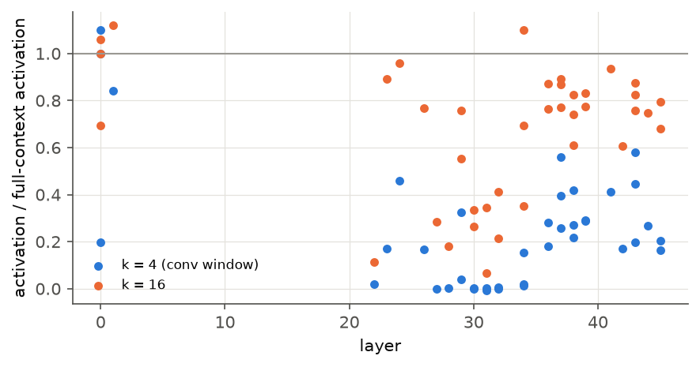

# Experiment 4: necessity and mechanism of the confirmed neurons (H3 and exploratory)

**Status:** done.
**Code:** `mechanism.py`, `phases/mechanism.py`.
**Results:** `results/mamba-1.4b-hf/h3_mechanism.json`, `truncation_survey.json`.

## Protocol
- **Positions.** The 200 strongest firings of each pole in the first 2,000 held-out windows (256k tokens). These neurons are extremely sparse: L30 N2121 has std 0.035 and kurtosis 23,777, and its discovery maximum is 10.7. So the 200 strongest held-out firings have a median of only 0.28, which is still about 8σ.
- **H3 (pre-registered).** Zero-ablate the neuron at every position and measure the mean drop in log p(actual next token) at those positions. The null is 20 random neurons of the same layer, ablated and measured at the same positions. H3 is supported if the target's drop exceeds all 20 (empirical p = 1/21).
- **Exploratory analyses.**
  - Factor split `a = y · SiLU(z)` at the firings, where `z` comes from the second half of `in_proj`.
  - Context truncation: activation with only the last k tokens (plus separator) as a fraction of its full-window value, for the first 50 firings.
  - Single-position activation patching of the neuron's median firing value into 200 random held-out positions. It measures the change in mean log p of the 10 promoted tokens, against 20 random neurons patched with their own typical firing value.

## Results
| Pole (steering concept) | Ablation drop (nats) | Null mean / max | p (H3) | Gate z < 0 | Double-negative | Ratio at k = 4 | k = 16 | k = 32 | Patch Δ log p(promoted) | Null max |
|---|---|---|---|---|---|---|---|---|---|---|
| L30 N2121 ("as") | −0.0030 | −0.0011 / 0.0030 | 0.76 ✗ | 0% | 0% | 0.00 | 0.18 | 0.40 | +0.13 | 1.77 |
| L28 N953 ("[") | 0.0018 | −0.0011 / 0.0014 | **0.048 ✓** | 0% | 0% | 0.00 | 0.13 | 0.74 | +0.23 | 1.03 |
| L32 N2669 ("set") | 0.0123 | 0.0047 / 0.0069 | **0.048 ✓** | 0% | 0% | 0.11 | 0.37 | 0.84 | +1.00 | 2.17 |

H3 p-values are uncorrected per pole, as pre-registered; under Holm over 3 poles both 0.048 values would become 0.14.

## Reading
1. **Necessity is weak or absent.**
   - For two of three neurons, ablation hurts next-token prediction at their firings more than any of 20 random neurons. The absolute effect is tiny (0.002–0.012 nats).
   - The "as" neuron, whose clamping does inject "as" (experiment 3), shows no necessity at all.
   - Together: these neurons are *sufficient* to push their token but are not individually *necessary*. This fits redundancy between neurons, or downstream self-repair ([McGrath et al., 2023](https://arxiv.org/abs/2307.15771)). That is a hypothesis, not tested here.
2. **The SSM factor carries the pole, not the gate.** In all 600 firings examined the gate was open (z > 0, median SiLU(z) 3.1–4.2). Whether the neuron fires is decided by the signed SSM output y. The double-negative regime (y < 0, z < 0 giving a > 0), which Goodfire flags as a tooling hazard for SwiGLU neurons, never occurred here.
3. **These neurons need long-range recurrent state.**
   - With only the convolution window (k ≤ 4 tokens) the activation is 0–11% of its full value.
   - It recovers gradually: 13–37% at 16 tokens, 40–84% at 32 tokens.
   - So these late-layer prediction neurons are not local n-gram detectors. Their firing depends on context carried by the SSM state, e.g. the first "as" of "as … as".
   - Caveat: truncated inputs start right after a separator, which is itself unusual context. The post-hoc truncation survey adds early-layer neurons as a control for this.
4. **Single-position patching is weak.** Writing the neuron's typical firing value at one random position raises its promoted tokens' log-probability by 0.13–1.0 nats. That is within the random-neuron range (p 0.33–0.86): a single typical firing does not move the output much beyond what an arbitrary neuron does. The large steering effects in experiment 3 come from sustained, much stronger activation at every position.

## Truncation survey (post hoc)
Context-truncation curves for all 39 screened poles. Each pole uses its first 50 held-out top firings, one per window. Values are the activation with only the last k tokens, as a fraction of the full-window activation.

| Layers | Poles | Median ratio, k = 4 (conv window) | Median ratio, k = 16 |
|---|---|---|---|
| 0–1 | 4 | **0.92** | 1.03 |
| 20–29 | 8 | 0.10 | 0.66 |
| 30–39 | 19 | 0.18 | 0.74 |
| 40–47 | 8 | 0.24 | 0.78 |

- **The control works.** Early-layer token detectors keep their activation with only 4 tokens of context. L0 N1037 ("periods before www domain names") and L0 N84 both stay at 1.00–1.10, and L1 N1296 at 0.84. So the near-zero ratios of later neurons are not an artefact of short inputs that start after a separator.
- **From layer 20 on, neurons need more than the convolution window.** The prediction neurons of layers 27–32 (`as`, `from`, `set`, `per`, `[`, digits) are the most long-range: 0–0.01 at k = 4, 0.18–0.41 at k = 16, and 0.41–0.70 at k = 32. Their firing relies on context the recurrent SSM state carries across dozens of tokens.
- **Later layers (34–45) recover faster** (k = 16: 0.6–0.9).
- **Caveat.** This is correlational with respect to the mechanism: we did not ablate the SSM state itself.

