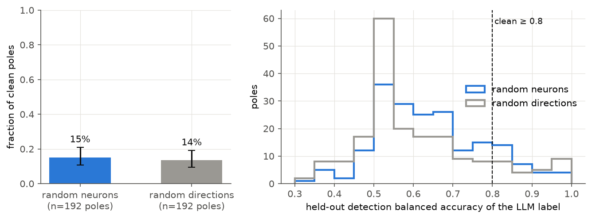

## Abstract
ABSTRACT_PLACEHOLDER

## 1 Introduction
Goodfire's essay *Neural Networks Are Already Clean* ([Cammarata et al., 2026](https://already-clean.goodfire.com/)) argues that most individual neurons of modern networks have one main job. In a preliminary audit of Qwen3-32B, about 90% of neuron poles had a single interpretable role. Turning a neuron up changes what the model writes. Almost all such evidence comes from transformers, whose MLP neurons are the classic object of study ([Geva et al., 2021](https://arxiv.org/abs/2012.14913); [Geva et al., 2022](https://arxiv.org/abs/2203.14680); [Voita et al., 2023](https://arxiv.org/abs/2309.04827); [Gurnee et al., 2023](https://arxiv.org/abs/2305.01610); [Gurnee et al., 2024](https://arxiv.org/abs/2401.12181); [Bills et al., 2023](https://openaipublic.blob.core.windows.net/neuron-explainer/paper/index.html)).

Selective state-space models such as Mamba ([Gu & Dao, 2023](https://arxiv.org/abs/2312.00752)) replace attention with an input-dependent linear recurrence. Their interpretability has been studied at the level of layers, circuits, hidden attention and subspaces:
- factual recall ([Sharma et al., 2024](https://arxiv.org/abs/2404.03646));
- the IOI circuit ([Ensign & Garriga-Alonso, 2024](https://arxiv.org/abs/2407.14008));
- hidden attention ([Ali et al., 2024](https://arxiv.org/abs/2403.01590));
- token-interaction decomposition ([Pitorro & Treviso, 2025](https://arxiv.org/abs/2502.15612));
- SAE feature universality with transformers ([Wang et al., 2025](https://arxiv.org/abs/2410.06672));
- activation-subspace steering ([Sunku Mohan et al., 2026](https://arxiv.org/abs/2602.22719)).

In our literature search we found no neuron-level atlas of a Mamba language model and no controlled single-neuron steering study.

We ask whether Mamba's natural neuron unit is interpretable and causally steerable. That unit is the gated SSM output feeding the output projection, the direct analogue of a SwiGLU neuron. Our contributions:
1. A tested definition of Mamba neurons and an open atlas of all 196,608 neurons of Mamba-1.4B: activation shape, both poles, top firings, write-side vocabulary projections and split stability.
2. A pre-registered privileged-basis test (H1). It compares local-LLM interpretability of random neurons against random directions in the same space.
3. A pre-registered single-neuron steering protocol (H2) with random-neuron, DiffMean, additive and prompting baselines, cluster bootstrap and Holm correction. It is followed by a post-hoc dose exploration and a second pre-registered confirmation (H2b) on fresh prompts.
4. Causal and mechanistic follow-ups (H3): ablation against random neurons, gate-vs-SSM factor decomposition, context truncation (convolution window vs SSM memory) and activation patching.

All code, data, logs (including every LLM prompt and reply), the pre-registration with its dated amendments, and an interactive viewer are public.

## 2 Background
**Mamba blocks.** A block maps the residual stream `h` through RMSNorm and an input projection to two width-4096 branches `x` and `z`. The `x` branch passes a depthwise causal convolution (kernel 4) and SiLU, and then a selective SSM with input-dependent step size Δ and matrices B, C and a diagonal A. There is one 16-dimensional state per channel. The output `y = SSM(x̃) + D ⊙ x̃` is gated elementwise by `SiLU(z)` and written back through `out_proj` ([Gu & Dao, 2023](https://arxiv.org/abs/2312.00752); HF [`modeling_mamba.py`](https://github.com/huggingface/transformers/blob/main/src/transformers/models/mamba/modeling_mamba.py)).

**Neurons and poles.** In a SwiGLU transformer MLP, the neuron `SiLU(W_g x) ⊙ (W_u x)` multiplies two signed factors before `down_proj` ([Shazeer, 2020](https://arxiv.org/abs/2002.05202)). Both signs can carry meaning, which Goodfire calls a neuron's poles. Mamba's gated SSM output has the same structure. A coordinate basis is *privileged* when the computation is not rotation-invariant there ([Elhage et al., 2022](https://transformer-circuits.pub/2022/toy_model/index.html)). Here that holds because of the elementwise gate and the per-channel recurrence.

**Explaining and scoring neurons.** Automated pipelines show an LLM the top-activating examples, ask for an explanation, and score it by simulation ([Bills et al., 2023](https://openaipublic.blob.core.windows.net/neuron-explainer/paper/index.html)) or by detection and fuzzing ([Paulo et al., 2024](https://arxiv.org/abs/2410.13928); [delphi](https://github.com/EleutherAI/delphi)). Transluce scaled this to every neuron of Llama-3.1-8B ([Choi et al., 2024](https://transluce.org/neuron-descriptions)). The vocabulary projection of a neuron's write vector identifies prediction and suppression neurons ([Geva et al., 2022](https://arxiv.org/abs/2203.14680); [Gurnee et al., 2024](https://arxiv.org/abs/2401.12181)).

**Steering.** Activation addition ([Turner et al., 2023](https://arxiv.org/abs/2308.10248)), contrastive activation addition ([Rimsky et al., 2024](https://arxiv.org/abs/2312.06681)) and SAE-feature clamping ([Templeton et al., 2024](https://transformer-circuits.pub/2024/scaling-monosemanticity/)) change model behaviour by editing activations. AxBench ([Wu et al., 2025](https://arxiv.org/abs/2501.17148)) evaluates steering with an LLM judge for concept relevance and fluency. It finds that simple baselines such as DiffMean and prompting often beat SAE-based steering. Single-neuron steering in language models has been shown for TopK LMs ([Takahashi et al., 2025](https://arxiv.org/abs/2506.21468)) and analysed through "control windows" ([Liu, 2026](https://arxiv.org/abs/2606.19831)).

## 3 Method
**Model and neuron site.** We study `state-spaces/mamba-1.4b-hf`: 48 blocks, d_model = 2048, d_inner = 4096, state size 16, trained on 300B Pile tokens. It runs in bf16 with the reference PyTorch scan of HF `transformers` 5.21 on one 8 GB laptop GPU. Neuron (ℓ, i) is coordinate i of the gated SSM output `a` at the input of `out_proj`. We read and edit it with a forward pre-hook. Unit tests verify three properties:
- `out_proj(a)` reproduces the mixer output.
- Adding δ to `a_i` equals adding `δ·W_out[:, i]` to the residual stream.
- Clamping a neuron to its own value is a no-op, in both prefill and cached decoding.

**Data.** `NeelNanda/pile-10k` documents are split by document (seed 0) into discovery (70%) and held-out (30%). They are cut into non-overlapping 128-token windows, at most 4 per document, each prefixed with `<|endoftext|>` (excluded from statistics). Discovery has 18,111 windows (2.32M tokens) and held-out has 5,078 windows (0.65M tokens). Labels, candidate selection and the steering screen use discovery data only. Detection scoring, prompts, DiffMean and ablations use held-out data only.

**Atlas.** A streaming pass per split records, for every neuron:
- float64 moments (mean, std, skew, Pearson kurtosis);
- the fraction of positive activations;
- the top-40 and bottom-40 activations with positions (the two poles).

The same quantities are recorded for 2 isotropic random unit directions per layer. The write side is `u_i = W_U(g ⊙ w_i)`, with `g` the final RMSNorm gain, together with its vocabulary kurtosis.

**Candidates.** Each of the 393,216 poles gets three rank-percentile scores, which are averaged:
- activation kurtosis;
- vocab kurtosis;
- input-output coherence: the mean vocab-z-scored `s·u_i` of the token that follows the pole's top firings.

The top 60 poles are kept, at most 3 per layer. An exploratory second stream (amendment 2) adds, for each of 8 distinctive Pile subsets, the 3 neurons with the largest |d′| of window-mean activation in-domain vs rest.

**Labels and detection (H1).** A local `qwen3.5:9b` (Ollama, temperature 0) writes a ≤15-word explanation per pole. Its input:
- the top-20 discovery firings as 33-token snippets with `<<highlights>>`;
- the most common peak and next tokens;
- the pole's 10 promoted tokens (computed identically for neurons and random directions).

It then classifies 20 shuffled, unhighlighted held-out snippets: the pole's 10 top firings and 10 random ones. The score is balanced accuracy, and a pole is clean if BA ≥ 0.8. H1 compares the clean rate of 192 random-neuron poles (2 neurons per layer, both poles) with 192 random-direction poles. It uses a one-sided Fisher exact test and a unit-cluster bootstrap CI.

**Steering (H2).** Neutral prompts are the first 16 tokens of held-out documents. Interventions apply at every position during sampled generation (40 tokens, temperature 0.7, top-p 0.95):
- *clamp*: `a_i ← s·c·|pole max|`;
- *add*: `a_i ← a_i + s·c·|pole max|`;
- *DiffMean*: the mean residual at the pole's held-out top firings minus the mean at random positions, after block ℓ, scaled to the add condition's residual norm ([AxBench](https://arxiv.org/abs/2501.17148));
- *prompting*: a `<concept>:` prefix;
- *random-neuron null*: the same relative clamp on random neurons of the same layer.

An LLM judge scores concept relevance and fluency (0–2) with the AxBench templates. The primary metric is their per-generation harmonic mean (HM). The concept is an output-side "steering concept" (e.g. "mentions of the word 'all'"), derived by the LLM from the label and promoted tokens before any steered text is judged (amendment 4).

The protocol runs in three stages:
1. **Screen** (prompt set A, 10 prompts). Every candidate pole with a clean label (39 poles) is clamped at c ∈ {2, 5, 10, 20}.
2. **Confirmation.** The ≤ 3 poles with the largest HM gain over unsteered are confirmed on prompt set B: 50 prompts on which the neuron is inactive, × 2 seeds, against an 80-neuron × 10-prompt random null (amendment 5).
3. **Decision rule.** H2 is supported if the paired clamp − unsteered HM difference has a 95% prompt-cluster-bootstrap CI above 0, the Holm-adjusted empirical p against the null is < 0.05, and the clamped judged fluency is ≥ 1.0.

**Mechanism (H3 and exploratory).** For each confirmed pole we use its 200 strongest firings in 2,000 held-out windows.
- **H3 ablation.** Zero-ablate the neuron at all positions and measure the drop in log p(actual next token), against 20 random same-layer neurons at the same positions.
- **Factor split.** Decompose `a = y·SiLU(z)` at the firings.
- **Context truncation.** Re-run each firing with only the last k ∈ {1, 2, 4, 8, 16, 32} tokens, to separate the 4-token convolution window from SSM memory.
- **Activation patching.** Set the neuron to its median firing value at one random held-out position, and measure the change in log p of its 10 promoted tokens against 20 random neurons.

**Pre-registration.** Hypotheses, metrics, tests and thresholds were committed to the public repository before the main-model analyses ([preregistration.md](https://github.com/BurnyCoder/mamba-neuron-mechanistic-interpretability/blob/main/reports/preregistration.md)). Every later change is a dated amendment listing what data existed at the time (Appendix A).

## 4 Results
### 4.1 Atlas: Mamba neurons are sparse, heavy-tailed detectors
Over 2.32M discovery tokens, the median neuron has kurtosis **354** (10th–90th percentile 46–3,064) and skew +7.4. 85.6% of neurons are positively skewed. For the 96 random directions the median kurtosis is **6.9** (Gaussian = 3) and the skew −0.03 (Table 1). Statistics replicate on the disjoint held-out documents, with Spearman ρ between splits of 0.96 (max), 0.94 (kurtosis) and 0.998 (std). Activation scale grows with depth: the median per-neuron maximum is 0.5 at layer 0 and 24.4 at layer 42.

By contrast, the write-side vocabulary projections are close to Gaussian. The median vocab kurtosis is 3.23–3.55 per layer, highest in layers 31–40. Prediction-like neurons are therefore a heavy tail, not the norm. The pre-registered candidate formula selected 60 late-layer poles (layers 27–47 apart from three). Almost all are next-token-prediction neurons for one word family, such as `all`, `way`, `nor`, `time`, `from`, `as`, `per` and `respectively`. Examples:
- L37 N1812 fires on "after" in "after all" and promotes `all`.
- L38 N918 fires on "make(s)" before "sense".

: **Table 1.** Activation shape of neurons and random directions (discovery split).

| | Neurons (196,608) | Random directions (96) |
|---|---|---|
| Kurtosis, median [p10, p90] | 354 [46, 3,064] | 6.9 [5.1, 19.7] |
| Skew, median [p10, p90] | +7.4 [−1.5, +31.4] | −0.03 [−0.44, +0.45] |
| Positively skewed | 85.6% | 45.8% |

### 4.2 H1: a local-LLM audit does not separate neurons from random directions
192 random-neuron poles and 192 random-direction poles were labelled and scored on held-out text (Figure 1). Clean rates (detection balanced accuracy ≥ 0.8) were **15.1%** (Wilson 95% CI 10.7–20.9%) for neurons and **13.5%** (9.4–19.1%) for directions. The difference is +1.6 points (unit-bootstrap 95% CI −5.7 to +8.3), with one-sided Fisher p = 0.39. **H1 is not supported.**

Mean balanced accuracy was 0.617 (0.597–0.637) for neurons against 0.583 (0.560–0.607) for directions; this comparison is post hoc. By depth, neurons stay flat at 0.63, 0.60 and 0.62 for layers 0–15, 16–31 and 32–47, while directions fall from 0.63 to 0.56. Formula candidates, which are not part of H1, reached a mean BA of 0.768 with 30 of 60 clean.

The detection judge agreed only moderately with blind ratings: κ = 0.55 on 40 decisions, below the pre-registered acceptance bar of 0.6. The audit's measurement floor is therefore high. With a 9B local labeller only about 15% of any units count as clean, far from the ~90% that Goodfire reports with expert auditing of Qwen3-32B.

### 4.3 Steering screen: concepts in, fluency out
Clamping each of 39 clean candidate poles at 2× its maximum (10 prompts) raised the mean judged concept score from 0.08 to **0.82**, and the share of generations with the concept present (score ≥ 1) from 6% to 48%. Judged fluency fell from 0.60 to 0.11, and distinct-2 from 0.91 to 0.39. Higher doses only made it worse (Table 2). The typical failure is repetition of the promoted token ("all all all …", "@@@@").

The steering judge was validated on 40 blind items. The concept judge is reliable (κ = 0.79, 87.5% exact agreement). The fluency judge is not (κ = 0.34): it is systematically harsh, with a mean of 0.25 against 0.65 for manual ratings.

: **Table 2.** Screen and post-hoc low-dose sweep, averaged over 39 poles (10 prompts each, prompt set A).

| Dose (× pole max) | Concept | P(concept ≥ 1) | Fluency (judge) | distinct-2 | HM |
|---|---|---|---|---|---|
| unsteered | 0.08 | 0.06 | 0.60 | 0.91 | 0.050 |
| 0.25 (post hoc) | 0.52 | 0.32 | 0.42 | 0.83 | **0.092** |
| 0.5 (post hoc) | 0.75 | 0.45 | 0.31 | 0.68 | 0.080 |
| 1 (post hoc) | 0.80 | 0.48 | 0.19 | 0.51 | 0.054 |
| 2 | 0.82 | 0.48 | 0.11 | 0.39 | 0.022 |
| 5 | 0.67 | 0.40 | 0.05 | 0.27 | 0.008 |
| 10 | 0.76 | 0.45 | 0.02 | 0.21 | 0.000 |
| 20 | 0.70 | 0.41 | 0.01 | 0.17 | 0.000 |

### 4.4 H2: pre-registered confirmation
H2_RESULT_PLACEHOLDER

### 4.5 Post-hoc low-dose regime and H2b
The pre-registered doses (≥ 2× the maximum) sit far outside these neurons' natural range. For the three H2 poles, the median of the 200 strongest firings in 256k held-out tokens is 9–38× below the discovery maximum. A post-hoc sweep at 0.25×, 0.5× and 1× found a regime where the concept enters without breaking the text (Table 2). The best poles kept judged fluency within 0.1–0.2 of the unsteered level (0.5–0.8 vs 0.6) and distinct-2 at 0.82–0.93 (unsteered 0.91):
- L30 N815 ("from", 0.5×): HM 0.67, concept 1.6.
- L30 N2121 ("as", 0.5×): HM 0.60, concept 1.6.
- L37 N71 ("first", 0.25×): HM 0.53, concept 1.6.

Example (L30 N2121, 0.5×): "…objects, and more specifically, **as** used in a mobile device." These three poles and doses were then pre-registered as H2b and tested on a fresh prompt set C.

H2B_RESULT_PLACEHOLDER

### 4.6 H3 and mechanism: sufficient but barely necessary, and driven by long-range SSM state
Results for the three H2 poles (Table 3):
- **Ablation (H3).** Zero-ablation lowered log p(next token) at the 200 strongest held-out firings by 0.0018 (L28 N953) and 0.0123 nats (L32 N2669). Both exceed all 20 random same-layer neurons (empirical p = 1/21, uncorrected). The "as" neuron L30 N2121 showed no effect (−0.003 nats, p = 0.76).
- **Gate.** At all 600 firings the gate was open (z > 0, median SiLU(z) 3.1–4.2), so the SSM factor y decides the pole. The double-negative regime never occurred.
- **Context truncation.** With only the last ≤ 4 tokens, which is Mamba's convolution window, the activations reached 0–11% of their full-context value. They recovered to 40–84% with 32 tokens. These neurons depend on context carried by the recurrent state.
- **Patching.** Writing a typical firing value at a single position changed promoted-token log-probabilities no more than random neurons did (p 0.33–0.86).

: **Table 3.** H3 and mechanism for the H2 poles (activation ratio = truncated / full context).

| Pole | Ablation drop (nats) | Null max | p | Ratio, k = 4 | Ratio, k = 32 | Gate open |
|---|---|---|---|---|---|---|
| L30 N2121 ("as") | −0.0030 | 0.0030 | 0.76 | 0.00 | 0.40 | 100% |
| L28 N953 ("[") | 0.0018 | 0.0014 | 0.048 | 0.00 | 0.74 | 100% |
| L32 N2669 ("set") | 0.0123 | 0.0069 | 0.048 | 0.11 | 0.84 | 100% |

SURVEY_RESULT_PLACEHOLDER

## 5 Discussion
DISCUSSION_PLACEHOLDER

## 6 Limitations
LIMITATIONS_PLACEHOLDER

## 7 Conclusion
CONCLUSION_PLACEHOLDER

## References
REFERENCES_PLACEHOLDER

## Appendix A: pre-registration amendments
APPENDIX_PLACEHOLDER

## AI statement
Claude Code (Anthropic's coding agent, model Claude Opus 5.5) wrote this codebase and this paper: the code, the experiments, the analyses and the text. A human, Libor Burian, provided the exact specification that was executed. Human cleanup and rewriting of the paper are in progress. The "manual" judge-validation ratings reported here were produced by Claude Code, not by a human annotator.
