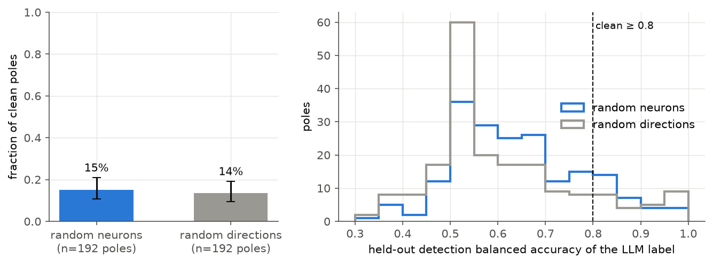
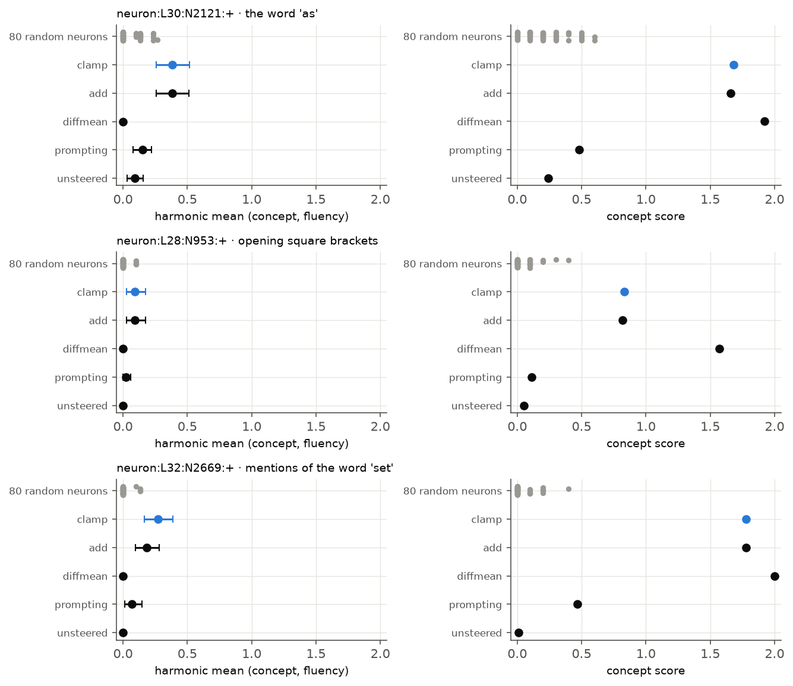
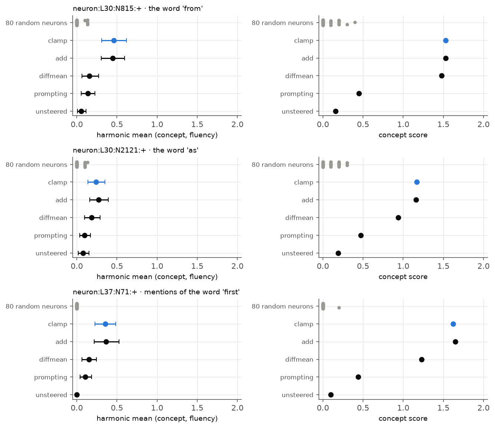
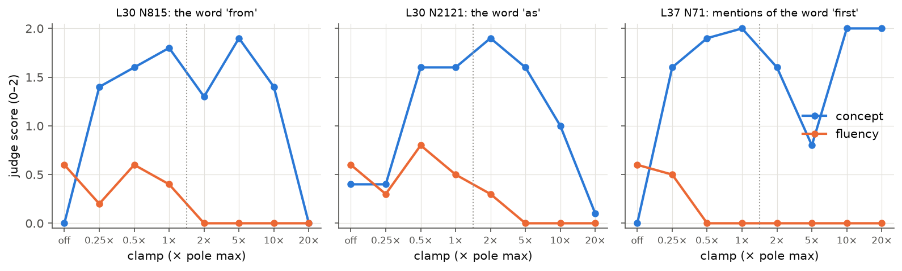
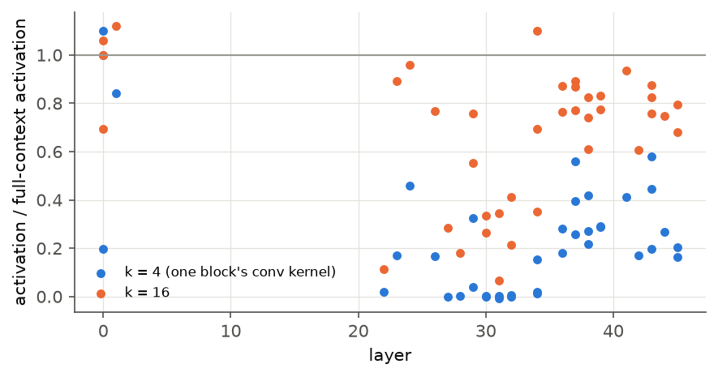

## Abstract
We study the natural neuron unit of the Mamba-1.4B state-space language model: the 196,608 coordinates of the gated SSM output that feed each block's output projection, the analogue of a SwiGLU MLP neuron. All analyses were pre-registered, with dated amendments.

- **Activation shape.** Almost all Mamba neurons are sparse, heavy-tailed detectors. Their median activation kurtosis is 354 (90% are above 46), against 6.9 for random directions in the same space.

- **Interpretability audit (H1, not supported, inconclusive).** On the pre-registered metric, a local 9B LLM's labels made random neurons "clean" about as often as random directions: 15.1% vs 13.5% clean poles, p = 0.39. The 95% CI rules out a clean-rate advantage above 8.3 points. A post-hoc comparison of mean detection accuracy does favour neurons, but only slightly: +0.034 [0.003, 0.065]. The detection judge failed its pre-registered validity bar (κ = 0.55, 95% CI 0.22–0.82, against reference ratings made by Claude Code), so this result is limited by the instrument.

- **Selected neurons are interpretable.** A pre-registered selection formula finds neurons whose labels transfer to held-out text (50% clean), mostly next-token-prediction neurons.

- **Steering at the pre-registered doses (H2, negative).** Clamping a single neuron at ≥ 2× its maximum injects its concept more strongly than every one of 80 random same-layer neurons (p = 1/81 each, Holm 0.037) and more than prompting. It also degrades text, so H2's pre-registered fluency criterion fails.

- **Steering at lower doses (H2b, supported by its pre-registered rule).** A post-hoc dose sweep found a regime at 0.25–0.5× the maximum that is gentler on the text. These doses are still several times a neuron's typical strong firing and are applied at every token. A second pre-registered confirmation on fresh prompts (H2b) tested three neurons, steering toward "from", "as" and "first":
  - They raised a concept–fluency harmonic mean from 0.00–0.08 to 0.24–0.46 and beat the random-neuron null (Holm p = 0.037 each).
  - A judge-free count of the target word gives the same result: 1.0–2.3 occurrences per 40 tokens, against 0.04–0.10 unsteered and at most 0.30 for any random neuron.
  - The point estimates met the pre-registered fluency margins. A post-hoc test of the same margins on confidence intervals passes for only one pole, at the margin. The fluency judge is unreliable on fluent text, and continuation NLL rose by 0.28–0.51 nats/token, so fluency preservation is not established.
  - Their mean HM was higher than a bare concept-prefix prompt and than DiffMean at the same norm. In post-hoc paired tests, 5 of these 6 differences remain significant after Holm correction. Neither baseline was tuned.

- **Necessity is weak.** Zero-ablation costs at most 0.012 nats where these neurons fire.

- **Mechanism (exploratory).**
  - For the three H2 neurons, the SiLU gate was open at all 600 examined firings, so the sign of these firings comes from the SSM factor. Because SiLU is bounded below by −0.28, an open gate is close to forced at the strongest firings. Which factor makes a neuron fire selectively was not tested.
  - In a post-hoc survey of 39 poles, those from layer 22 on keep only 10–24% (median per layer bin) of their activation when given just the last 4 tokens, against 92% for the 4 poles in layers 0–1. This fits a dependence on longer context. It is not separated from the effect of a short input as such, or from the type of neuron (no pole lies in layers 2–21). It also does not tell whether the context arrives through the SSM state or through convolutions stacked across layers.

Code, data, all LLM prompts and replies, and an interactive viewer are public.

## 1 Introduction
Goodfire's essay *Neural Networks Are Already Clean* ([Cammarata, 2026](https://already-clean.goodfire.com/)) argues that most individual neurons of modern networks have one main job. From preliminary audits of Qwen3-32B, it estimates that roughly 90% of neuron poles have one main job. Turning a neuron up changes what the model writes. Almost all such evidence comes from transformers, whose MLP neurons are the classic object of study ([Geva et al., 2021](https://arxiv.org/abs/2012.14913); [Geva et al., 2022](https://arxiv.org/abs/2203.14680); [Voita et al., 2024](https://arxiv.org/abs/2309.04827); [Gurnee et al., 2023](https://arxiv.org/abs/2305.01610); [Gurnee et al., 2024](https://arxiv.org/abs/2401.12181); [Bills et al., 2023](https://openaipublic.blob.core.windows.net/neuron-explainer/paper/index.html)).

Selective state-space models such as Mamba ([Gu & Dao, 2023](https://arxiv.org/abs/2312.00752)) replace attention with an input-dependent linear recurrence. Their interpretability has been studied at the level of layers, circuits, hidden attention and subspaces:

- factual recall ([Sharma et al., 2024](https://arxiv.org/abs/2404.03646));

- the IOI circuit ([Ensign & Garriga-Alonso, 2024](https://arxiv.org/abs/2407.14008));

- hidden attention ([Ali et al., 2024](https://arxiv.org/abs/2403.01590));

- token-interaction decomposition ([Pitorro & Treviso, 2025](https://arxiv.org/abs/2502.15612));

- SAE feature universality with transformers ([Wang et al., 2025](https://arxiv.org/abs/2410.06672));

- activation-subspace steering ([Sunku Mohan et al., 2026](https://arxiv.org/abs/2602.22719)).

In our literature search we found no neuron-level atlas of a Mamba language model and no controlled single-neuron steering study.

We ask whether Mamba's natural neuron unit is interpretable and causally steerable. That unit is the gated SSM output feeding the output projection, the direct analogue of a SwiGLU neuron. Our contributions:

1. A tested definition of Mamba neurons and an open atlas of all 196,608 neurons of Mamba-1.4B: activation shape, both poles, top firings, write-side vocabulary projections and split stability.

2. A pre-registered privileged-basis test (H1). It compares local-LLM interpretability of random neurons against random directions in the same space.

3. A pre-registered single-neuron steering protocol (H2) with random-neuron, DiffMean, additive and prompting baselines, cluster bootstrap and Holm correction. It is followed by a post-hoc dose exploration and a second pre-registered confirmation (H2b) on fresh prompts.

4. Causal and mechanistic follow-ups (H3): ablation against random neurons, gate-vs-SSM factor decomposition, context truncation (how much context a firing needs) and activation patching.

All code, data, logs (including every LLM prompt and reply), the pre-registration with its dated amendments, and an interactive viewer are public.

## 2 Background
**Mamba blocks.** A block maps the residual stream `h` through RMSNorm and an input projection to two width-4096 branches `x` and `z`. The `x` branch passes a depthwise causal convolution (kernel 4) and SiLU, and then a selective SSM with input-dependent step size Δ and matrices B, C and a diagonal A. There is one 16-dimensional state per channel. The output `y = SSM(x̃) + D ⊙ x̃` is gated elementwise by `SiLU(z)` and written back through `out_proj` ([Gu & Dao, 2023](https://arxiv.org/abs/2312.00752); HF [`modeling_mamba.py`](https://github.com/huggingface/transformers/blob/main/src/transformers/models/mamba/modeling_mamba.py)).

**Neurons and poles.** In a SwiGLU transformer MLP, the neuron `SiLU(W_g x) ⊙ (W_u x)` multiplies two signed factors before `down_proj` ([Shazeer, 2020](https://arxiv.org/abs/2002.05202)). Both signs can carry meaning, which Goodfire calls a neuron's poles. Mamba's gated SSM output has the same structure. A coordinate basis is *privileged* when the computation is not rotation-invariant there ([Elhage et al., 2022](https://transformer-circuits.pub/2022/toy_model/index.html)). Here that holds because of the elementwise gate and the per-channel recurrence.

**Explaining and scoring neurons.** Automated pipelines show an LLM the top-activating examples, ask for an explanation, and score it by simulation ([Bills et al., 2023](https://openaipublic.blob.core.windows.net/neuron-explainer/paper/index.html)) or by detection and fuzzing ([Paulo et al., 2024](https://arxiv.org/abs/2410.13928); [delphi](https://github.com/EleutherAI/delphi)). Transluce scaled this to every MLP neuron of Llama-3.1-8B-Instruct ([Choi et al., 2024](https://transluce.org/neuron-descriptions)). The vocabulary projection of a neuron's write vector identifies prediction and suppression neurons ([Geva et al., 2022](https://arxiv.org/abs/2203.14680); [Gurnee et al., 2024](https://arxiv.org/abs/2401.12181)).

**Steering.** Activation addition ([Turner et al., 2023](https://arxiv.org/abs/2308.10248)), contrastive activation addition ([Panickssery (formerly Rimsky) et al., 2024](https://arxiv.org/abs/2312.06681)) and SAE-feature clamping ([Templeton et al., 2024](https://transformer-circuits.pub/2024/scaling-monosemanticity/)) change model behaviour by editing activations. AxBench ([Wu et al., 2025](https://arxiv.org/abs/2501.17148)) evaluates steering with an LLM judge that rates concept relevance, instruction relevance and fluency, and takes their harmonic mean. Its findings:

- prompting steers best, followed by finetuning;

- representation-based methods such as DiffMean detect concepts best;

- SAEs are not competitive on either task.

Single-neuron steering in language models has been shown for TopK LMs ([Takahashi et al., 2025](https://arxiv.org/abs/2506.21468)) and analysed through "control windows" ([Liu, 2026](https://arxiv.org/abs/2606.19831)).

## 3 Method
**Model and neuron site.** We study `state-spaces/mamba-1.4b-hf`: 48 blocks, d_model = 2048, d_inner = 4096, state size 16, trained on 300B Pile tokens. It runs in bf16 with the reference PyTorch scan of HF `transformers` 5.21 on one 8 GB laptop GPU. Neuron (ℓ, i) is coordinate i of the gated SSM output `a` at the input of `out_proj`. We read and edit it with a forward pre-hook. Unit tests verify three properties:

- `out_proj(a)` reproduces the mixer output.

- Adding δ to `a_i` equals adding `δ·W_out[:, i]` to the residual stream.

- Clamping a neuron to its own value is a no-op, and hooks fire at every step of cached decoding without changing the generated tokens.

**Data.** `NeelNanda/pile-10k` documents are split by document (seed 0) into discovery (70%) and held-out (30%). They are cut into non-overlapping 128-token windows, at most 4 per document, each prefixed with `<|endoftext|>` (excluded from statistics). Discovery has 18,111 windows (2.32M tokens) and held-out has 5,078 windows (0.65M tokens). Labels and candidate selection use discovery data only. Held-out data is used for detection scoring, all steering prompts (disjoint sets A, B and C of held-out document openings), DiffMean and ablations. The pre-registration had listed the steering screen under discovery data, but its prompts were held-out openings, like all neutral prompts (Appendix A, amendment 8).

**Atlas.** A streaming pass per split records, for every neuron:

- float64 moments (mean, std, skew, Pearson kurtosis);

- the fraction of positive activations;

- the top-40 and bottom-40 activations with positions (the two poles).

The same quantities are recorded for 2 isotropic random unit directions per layer. The write side is `u_i = W_U(g ⊙ w_i)`, with `g` the final RMSNorm gain, together with its vocabulary kurtosis.

**Candidates.** Each of the 393,216 poles gets three rank-percentile scores, which are averaged:

- activation kurtosis;

- vocab kurtosis;

- input-output coherence: the mean vocab-z-scored `s·u_i` of the token that follows the pole's 40 stored top firings (the pre-registration text said 20; amendment 8).

The top 60 poles are kept, at most 3 per layer. An exploratory second stream (amendment 2) adds, for each of 8 distinctive Pile subsets, the 3 neurons with the largest |d′| of window-mean activation in-domain vs rest.

**Labels and detection (H1).** A local `qwen3.5:9b` (Ollama, temperature 0) writes a ≤15-word explanation per pole. Its input:

- the top-20 discovery firings as 33-token snippets with `<<highlights>>`;

- the most common peak and next tokens;

- the pole's 10 promoted tokens (computed identically for neurons and random directions).

It then classifies 20 shuffled, unhighlighted held-out snippets: the pole's 10 top firings and 10 random ones. The score is balanced accuracy, and a pole is clean if BA ≥ 0.8. H1 compares the clean rate of 192 random-neuron poles (2 neurons per layer, both poles) with 192 random-direction poles. It uses a one-sided Fisher exact test and a unit-cluster bootstrap CI.

**Steering (H2).** Neutral prompts are the first 16 tokens of held-out documents. Interventions apply at every position during sampled generation (40 tokens, temperature 0.7, top-p 0.95):

- *clamp*: `a_i ← s·c·|pole max|`;

- *add*: `a_i ← a_i + s·c·|pole max|`;

- *DiffMean*: the mean residual at the pole's held-out top firings minus the mean at random positions, after block ℓ, scaled to the add condition's residual norm ([AxBench](https://arxiv.org/abs/2501.17148));

- *prompting*: a `<concept>:` prefix;

- *random-neuron null*: the same relative clamp on random neurons of the same layer.

An LLM judge scores concept relevance and fluency (0–2) with the AxBench templates. The primary metric is their per-generation harmonic mean (HM). AxBench also scores instruction relevance; we drop it because our prompts are text to continue, not instructions. The concept is an output-side "steering concept" (e.g. "mentions of the word 'all'"), derived by the LLM from the label and promoted tokens before any steered text is judged (amendment 4).

The protocol runs in three stages:

1. **Screen** (prompt set A, 10 prompts). Every candidate pole with a clean label (39 poles) is clamped at c ∈ {2, 5, 10, 20}.

2. **Confirmation.** The ≤ 3 poles with the largest HM gain over unsteered are confirmed on prompt set B: 50 prompts on which the neuron stays below its 90th percentile (estimated on the first 200 discovery windows), × 2 seeds, against an 80-neuron × 10-prompt random null (amendment 5).

3. **Decision rule.** H2 is supported if the paired clamp − unsteered HM difference has a 95% prompt-cluster-bootstrap CI above 0, the Holm-adjusted empirical p against the null is < 0.05, and the clamped judged fluency is ≥ 1.0.

**Post-hoc robustness analyses (independent audit, amendment 9).** These were added after all results existed and use only the stored judged generations. None of them changes a pre-registered verdict.

- **Judge-free concept score.** The number of times the pole's top promoted token appears in each 40-token continuation (whole words, case-insensitive), tested against the same null.
- **Like-for-like null.** The target is scored only on the null's own 10 prompts and seed.
- **Fluency on confidence intervals.** Paired clamp − unsteered CIs for judged fluency, distinct-2 and NLL. The pre-registered non-inferiority margins are then tested on the CI lower bounds instead of point estimates ([Piaggio et al., 2012](https://doi.org/10.1001/jama.2012.87802)).
- **Baseline comparisons.** Bootstrap p-values for clamp vs prompting and clamp vs DiffMean, from the same prompt-cluster resamples as the CIs ([Efron & Tibshirani, 1993](https://doi.org/10.1201/9780429246593)). They are Holm-corrected over the 6 comparisons of each confirmation.
- **H1 and judge validity.** A comparison of mean detection balanced accuracy, and item-bootstrap CIs for every κ.

**Mechanism (H3 and exploratory).** For each confirmed pole we use its 200 strongest firings in 2,000 held-out windows. The ablation uses the 196–199 of them that have a next token inside the window.

- **H3 ablation.** Zero-ablate the neuron at all positions and measure the drop in log p(actual next token), against 20 random same-layer neurons at the same positions.

- **Factor split.** Decompose `a = y·SiLU(z)` at the firings.

- **Context truncation.** Re-run the 50 strongest of these firings with only the last k ∈ {1, 2, 4, 8, 16, 32} tokens, to measure how much context it needs. k = 4 is one block's convolution kernel, but convolutions stacked over layers reach back 3ℓ + 4 tokens at layer ℓ. This test therefore does not separate the convolution path from SSM memory.

- **Activation patching.** Set the neuron to its median firing value at a single random held-out position (repeated over 200 such positions), and measure the change in log p of its 10 promoted tokens against 20 random neurons. Each null neuron is set to the median of its 40 strongest discovery activations, a more extreme value than the target's donor, so this comparison is not like-for-like.

**Pre-registration.** Hypotheses, metrics, tests and thresholds were committed to the public repository before the main-model analyses ([preregistration.md](https://github.com/BurnyCoder/mamba-neuron-mechanistic-interpretability/blob/main/reports/preregistration.md)). Every later change is a dated amendment listing what data existed at the time (Appendix A).

## 4 Results
### 4.1 Atlas: Mamba neurons are sparse, heavy-tailed detectors
Over 2.32M discovery tokens, the median neuron has kurtosis **354** (10th–90th percentile 46–3,064) and skew +7.4. 85.6% of neurons are positively skewed. For the 96 random directions the median kurtosis is **6.9** (Gaussian = 3) and the skew −0.03 (Table 1). Statistics replicate on the disjoint held-out documents, with Spearman ρ between splits of 0.96 (max), 0.94 (kurtosis) and 0.998 (std). Activation scale grows with depth: the median per-neuron maximum is 0.5 at layer 0 and plateaus at 24–26 in layers 40–45 (22.1 at layer 47).

By contrast, the write-side vocabulary projections are close to Gaussian. The median vocab kurtosis is 3.23–3.55 per layer, highest in layers 31–40. Prediction-like neurons are therefore a heavy tail, not the norm. The pre-registered candidate formula selected 60 late-layer poles (layers 27–47 apart from three). Almost all are next-token-prediction neurons for one word family, such as `all`, `way`, `nor`, `time`, `from`, `as`, `per` and `respectively`. Examples:

- L37 N1812 fires on the token before "all" ("after all", "at all", "of all") and promotes `all`.

- L38 N918 fires on "make(s)" before "sense".

: **Table 1.** Activation shape of neurons and random directions (discovery split).

| | Neurons (196,608) | Random directions (96) |
|---|---|---|
| Kurtosis, median [p10, p90] | 354 [46, 3,064] | 6.9 [5.1, 19.7] |
| Skew, median [p10, p90] | +7.4 [−1.5, +31.4] | −0.03 [−0.44, +0.45] |
| Positively skewed | 85.6% | 45.8% |

### 4.2 H1: the pre-registered clean-rate test does not separate neurons from random directions
192 random-neuron poles and 192 random-direction poles were labelled and scored on held-out text (Figure 1). Clean rates (detection balanced accuracy ≥ 0.8) were **15.1%** (Wilson 95% CI 10.7–20.9%) for neurons and **13.5%** (9.4–19.1%) for directions. The difference is +1.6 points (unit-bootstrap 95% CI −5.7 to +8.3), with one-sided Fisher p = 0.39. **H1 is not supported.** The CI rules out a clean-rate advantage for neurons larger than 8.3 points under this instrument. It does not show that there is no difference.

The 0.8 threshold dichotomises a noisy 20-snippet score, so we also compared the continuous score (post hoc):

- **Mean balanced accuracy.** 0.617 (0.597–0.637) for neurons against 0.583 (0.560–0.607) for directions. The difference is +0.034, unit-bootstrap 95% CI 0.003 to 0.065, one-sided Mann-Whitney p = 0.0015 on per-unit means. It is small but excludes 0.
- **By depth.** Neurons stay flat at 0.63, 0.60 and 0.62 for layers 0–15, 16–31 and 32–47, while directions fall from 0.63 to 0.56. The difference is therefore confined to layers 16–47.
- **Other thresholds.** At a threshold of 0.6 the clean rates are 55.7% vs 40.1%. At 0.9 they are 4.2% vs 7.3%.

Formula candidates, which are not part of H1, reached a mean BA of 0.768 with 30 of 60 clean.

The detection judge agreed only moderately with reference ratings made by Claude Code: κ = 0.55 on 40 decisions (item-bootstrap 95% CI 0.22–0.82). That is below the pre-registered acceptance bar of 0.6, so by the pre-registration the judge was not accepted, and H1 is best read as inconclusive rather than falsified. The CI is wide enough that the pass/fail outcome itself is uncertain. The audit's measurement floor is high. With a 9B local labeller only about 15% of any units count as clean. That is far from the roughly 90% that Goodfire estimates for Qwen3-32B, from preliminary audits whose procedure the essay does not detail.

### 4.3 Steering screen: concepts in, fluency out
Clamping each of 39 clean candidate poles at 2× its maximum (10 prompts) raised the mean judged concept score from 0.08 to **0.82**, and the share of generations with the concept present (score ≥ 1) from 6% to 48%. Judged fluency fell from 0.60 to 0.11, and distinct-2 from 0.91 to 0.39. Higher doses only made it worse (Table 2). The typical failure is repetition of the promoted token ("all all all …", "@@@@").

The steering judge was validated on 40 screen generations, rated by Claude Code from an item file that omits the judge's ratings.

- **Concept judge.** It agrees well with the reference: κ = 0.79 (95% CI 0.62–0.95), 87.5% exact agreement.
- **Fluency judge.** It does not (κ = 0.34, 0.17–0.53). It is systematically harsh, with a mean of 0.25 against 0.65 for the reference. Its κ is propped up by agreement on degenerate high-dose text, which both raters score 0. On the 9 unsteered items the reference gives 1.89 and the judge 0.67, so the judge cannot reliably rank fluent texts.
- **Coverage.** No validation item comes from the 0.25–1× regime where H2b is tested (levels 0, 2, 5, 10 and 20× had 9, 10, 10, 6 and 5 items).

: **Table 2.** Screen and post-hoc low-dose sweep, averaged over 39 poles (10 prompts each, prompt set A).

| Dose (× pole max) | Concept | P(concept ≥ 1) | Fluency (judge) | distinct-2 | HM |
|---|---|---|---|---|---|
| unsteered | 0.08 | 0.06 | 0.60 | 0.91 | 0.050 |
| 0.25 (post hoc) | 0.52 | 0.32 | 0.42 | 0.83 | **0.092** |
| 0.5 (post hoc) | 0.75 | 0.45 | 0.31 | 0.68 | 0.080 |
| 1 (post hoc) | 0.80 | 0.48 | 0.19 | 0.51 | 0.054 |
| 2 | 0.82 | 0.48 | 0.11 | 0.39 | 0.022 |
| 5 | 0.67 | 0.40 | 0.05 | 0.27 | 0.008 |
| 10 | 0.76 | 0.45 | 0.02 | 0.21 | 0.000 |
| 20 | 0.69 | 0.41 | 0.01 | 0.17 | 0.000 |

### 4.4 H2: pre-registered confirmation
The three pre-registered poles were each confirmed on 50 fresh neutral prompts (47 for L32 N2669) × 2 seeds, against an 80-neuron random null (Table 4, Figure 2). Clamping raised the HM above unsteered for all three. The paired 95% CIs exclude 0: +0.29 for "as", +0.09 for "[", +0.27 for "set".

Against the random-neuron null:

- **Concept alone.** Every target beat all 80 null neurons on the concept score (p = 1/81, Holm 0.037).

- **Primary HM metric.** L30 N2121 and L32 N2669 beat the null after Holm correction (p = 0.037); L28 N953 did not (p = 0.074).

- **Fluency.** No pole reached the pre-registered absolute judged fluency of ≥ 1.0. Unsteered text scored only 0.41–0.46 with this judge.

**H2 is therefore not supported as pre-registered.** Under the non-inferiority fluency rule later registered for H2b (distinct-2 ≥ 0.9 × unsteered and judged fluency ≥ unsteered − 0.2), L30 N2121 would pass. That reading is post hoc for H2.

The baselines behaved differently:

- **Prompting** with the concept as a prefix produced lower HM than neuron clamping for all three poles (0.15, 0.02, 0.07). A post-hoc paired bootstrap gives clamp − prompting of +0.23 [0.09, 0.39] for "as" and +0.20 [0.08, 0.33] for "set", but only +0.07 [−0.01, 0.16] for "[". The same pattern holds after Holm correction over the 6 clamp-vs-baseline comparisons. This baseline is a bare `<concept>:` prefix on a base model that is not instruction-tuned. It is much weaker than AxBench's prompting baseline, which uses written instructions for instruction-tuned models, so it cannot be set against AxBench's finding that prompting steers best.

- **DiffMean** at the same residual-norm budget produced maximal concept but degenerate text (distinct-2 0.03–0.17, HM 0), whereas the neuron's write direction kept distinct-2 at 0.75–0.85.

- **Additive steering** gave the same concept scores as clamping, because these neurons are near zero outside their firings. Its HM was nearly equal for "as" and "[" but lower for "set" (0.18 vs 0.27).

: **Table 4.** H2 confirmation (prompt set B). HM = harmonic mean of the judge's concept and fluency scores (0–2).

| Pole · dose | Unsteered HM | Clamp HM [95% CI] | Prompting HM | DiffMean HM | Null HM mean / max | Holm p | Clamp concept | Clamp distinct-2 |
|---|---|---|---|---|---|---|---|---|
| L30 N2121 "as" · 2× | 0.09 | **0.38** [0.26, 0.52] | 0.15 | 0.00 | 0.05 / 0.27 | **0.037** | 1.68 | 0.85 |
| L28 N953 "[" · 5× | 0.00 | 0.09 [0.03, 0.17] | 0.02 | 0.00 | 0.01 / 0.10 | 0.074 | 0.83 | 0.77 |
| L32 N2669 "set" · 2× | 0.00 | **0.27** [0.17, 0.39] | 0.07 | 0.00 | 0.01 / 0.13 | **0.037** | 1.78 | 0.75 |

### 4.5 Post-hoc low-dose regime and H2b
The pre-registered doses (≥ 2× the maximum) sit far outside these neurons' natural range. For the three H2 poles, the median of the 200 strongest firings in 256k held-out tokens is 9–39× below the discovery maximum. The lower doses are also well above that range: for L30 N2121, which appears in both confirmations, 0.5× its maximum is about 19× the median of its 200 strongest held-out firings, applied at every token. A post-hoc sweep at 0.25×, 0.5× and 1× found a regime where the concept enters with much less damage to the text (Table 2). The best poles kept judged fluency within 0.2 of the unsteered level (0.5–0.8 vs 0.6) and distinct-2 at 0.82–0.93 (unsteered 0.91):

- L30 N815 ("from", 0.5×): HM 0.67, concept 1.6.

- L30 N2121 ("as", 0.5×): HM 0.60, concept 1.6.

- L37 N71 ("first", 0.25×): HM 0.53, concept 1.6.

Example (L30 N2121, 0.5×): "…objects, and more specifically, **as** used in a mobile device." These three poles and doses were then pre-registered as H2b and tested on a fresh prompt set C.

On fresh prompt set C (Table 5, Figure 4), all three low-dose poles raised the HM well above unsteered:

| Pole | Dose | Clamp − unsteered HM [95% CI] |
|---|---|---|
| "from" | 0.5× | +0.40 [0.25, 0.56] |
| "as" | 0.5× | +0.16 [0.07, 0.26] |
| "first" | 0.25× | +0.35 [0.23, 0.49] |

Each beat all 80 random same-layer neurons (Holm p = 0.037) and met the pre-registered fluency rule. The point estimates of judged fluency stayed within 0.09 of unsteered, and distinct-2 was ≥ 0.87 against 0.93. **H2b is supported for all three neurons by its pre-registered rule.**

That rule compares point estimates. The fluency evidence is weaker than the verdict suggests (post hoc, Table 5):

- **Confidence intervals.** The clamp − unsteered judged-fluency CIs are [−0.20, 0.13] for "from", [−0.22, 0.04] for "as" and [−0.17, 0.17] for "first". Testing the same margins on CI lower bounds, as in standard non-inferiority analysis ([Piaggio et al., 2012](https://doi.org/10.1001/jama.2012.87802)), passes only for "from", exactly at the −0.2 margin. "as" fails on fluency, and "first" just misses the distinct-2 margin: the lower bound of clamp − 0.9 × unsteered is −0.004.
- **Instrument.** The fluency judge rates unsteered text near the floor (0.41–0.48 of 2) and cannot reliably rank fluent texts (Section 4.3). That floor makes a fixed 0.2-point margin easy to meet.
- **NLL.** Continuation NLL under the unsteered model, a pre-registered secondary metric, rose by +0.51 [0.37, 0.67], +0.28 [0.16, 0.42] and +0.46 [0.26, 0.68] nats/token. Part of this rise is mechanical, because each injected word is itself improbable under the unsteered model. The stored per-generation NLLs cannot separate the two.

We therefore read H2b as strong evidence for specific concept injection at these doses. Fluency preservation is not established.

Neuron clamping also had a higher mean HM than both baselines for every pole: prompting (0.10–0.14) and DiffMean at the same residual norm (0.15–0.19). In a post-hoc paired bootstrap, five of the six differences remain significant after Holm correction over the six (Holm p ≤ 0.039). The exception is "as" vs DiffMean, +0.05 [−0.06, 0.17], Holm p = 0.37. Two caveats apply. The dose was chosen to maximise the neuron's HM on prompt set A, while neither baseline was tuned: DiffMean was tested at only this one norm, and prompting is the bare-prefix baseline described in Section 4.4. And by the judge-free word count (Section 4.6), DiffMean injects "from" and "as" *more* often than the neuron (10.3 and 3.0 vs 2.2 and 1.0 per 40 tokens), at a clear cost in repetition (distinct-2 0.67 vs 0.90 for "from"). Example (L37 N71, 0.25×): "…have been recognized as the **first** step in understanding the biomechanical behavior of the bone."

: **Table 5.** H2b confirmation (prompt set C).

| Pole · dose | Unsteered HM | Clamp HM [95% CI] | Prompting HM | DiffMean HM | Null HM max | Holm p | Fluency (clamp / unst.) | Fluency diff [95% CI] (post hoc) | distinct-2 (clamp / unst.) | NLL (clamp / unst.) |
|---|---|---|---|---|---|---|---|---|---|---|
| L30 N815 "from" · 0.5× | 0.06 | **0.46** [0.31, 0.62] | 0.14 | 0.16 | 0.13 | 0.037 | 0.45 / 0.48 | −0.03 [−0.20, 0.13] | 0.90 / 0.93 | 1.58 / 1.07 |
| L30 N2121 "as" · 0.5× | 0.08 | **0.24** [0.14, 0.35] | 0.10 | 0.19 | 0.13 | 0.037 | 0.32 / 0.41 | −0.09 [−0.22, 0.04] | 0.92 / 0.93 | 1.41 / 1.13 |
| L37 N71 "first" · 0.25× | 0.00 | **0.35** [0.23, 0.49] | 0.11 | 0.15 | 0.00 | 0.037 | 0.42 / 0.42 | 0.00 [−0.17, 0.17] | 0.87 / 0.93 | 1.64 / 1.18 |

### 4.6 Judge-free robustness check (post hoc)
Every concept above is one word or symbol, so we can count it directly instead of asking the judge. For each pole we counted its top promoted token in each 40-token continuation (Table 6).

- **Against unsteered text and the null.** For all six confirmations, clamping raised the count far above unsteered text and above every one of the 80 random neurons (p = 1/81, Holm 0.037).
- **Like-for-like.** The same holds when the target is scored only on the null's own 10 prompts and seed (p = 1/81 for all six).
- **Specific concept injection** therefore does not depend on the LLM judge.

The like-for-like version of the pre-registered HM test is weaker for two poles. H2 "[" scores HM 0.00 on those 10 generations (p = 1.0), and H2b "as" scores 0.10 (p = 0.136). The registered design compares the target's 100-generation mean with the null's 10-generation means. That is conservative in expectation, so the verdicts stand, but the HM significance of H2b "as" depends on it.

: **Table 6.** Occurrences of the pole's top promoted token per 40-token continuation (post hoc). Null = 80 random same-layer neurons at the same relative dose (10 generations each).

| Pole · dose (stage) | Token | Unsteered | Clamp | Clamp − unsteered [95% CI] | Prompting | DiffMean | Null mean / max |
|---|---|---|---|---|---|---|---|
| L30 N2121 · 2× (H2) | as | 0.07 | 1.98 | +1.91 [1.57, 2.25] | 0.27 | 37.2 | 0.09 / 0.40 |
| L28 N953 · 5× (H2) | [ | 0.01 | 6.91 | +6.90 [4.94, 9.09] | 0.10 | 18.1 | 0.02 / 1.00 |
| L32 N2669 · 2× (H2) | set | 0.00 | 4.79 | +4.79 [4.18, 5.39] | 0.30 | 39.0 | 0.01 / 0.20 |
| L30 N815 · 0.5× (H2b) | from | 0.08 | 2.18 | +2.10 [1.61, 2.72] | 0.27 | 10.3 | 0.03 / 0.20 |
| L30 N2121 · 0.5× (H2b) | as | 0.10 | 1.02 | +0.92 [0.70, 1.15] | 0.37 | 2.96 | 0.10 / 0.30 |
| L37 N71 · 0.25× (H2b) | first | 0.04 | 2.27 | +2.23 [1.74, 2.78] | 0.27 | 1.15 | 0.00 / 0.10 |

### 4.7 H3 and mechanism: sufficient at supra-natural doses, barely necessary, and dependent on long inputs
Results for the three H2 poles (Table 3):

- **Ablation (H3).** Zero-ablation lowered log p(next token) at the strongest held-out firings (196–199 per pole) by 0.0018 (L28 N953) and 0.0123 nats (L32 N2669). Both exceed all 20 random same-layer neurons (empirical p = 1/21, uncorrected, as pre-registered). Neither survives Holm correction over the three poles (0.14). The 0.0018-nat effect is also smaller than the spread of random-neuron ablation effects across the three poles (−0.0055 to +0.0069 nats). The "as" neuron L30 N2121 showed no effect (−0.003 nats, p = 0.76).

- **Gate.** At all 600 firings the gate was open (z > 0, median SiLU(z) 3.1–4.2), so the sign of these firings comes from the SSM factor y (which includes the D skip term). The double-negative regime never occurred. This is largely expected: SiLU(z) ≥ −0.28, so a closed gate caps |a| at 0.28·|y|, and strong firings almost need an open gate. The same bound holds for SwiGLU. We measured the gate only at firings, so whether the gate or y decides *where* a neuron fires was not tested.

- **Context truncation.** With only the last ≤ 4 tokens (one block's convolution kernel), the activations reached 0–11% of their full-context value. They recovered to 40–84% with 32 tokens. Truncation both removes context and shortens the input, so this fits a dependence on dozens of tokens of context, but it does not rule out an effect of short inputs as such at deep layers. Nor does it show whether the context is carried by the recurrent state or by convolutions stacked across layers.

- **Patching.** Writing a typical firing value at a single position changed promoted-token log-probabilities no more than random neurons did (p 0.33–0.86). The null neurons were patched with relatively stronger values (Section 3), so this comparison is not like-for-like.

: **Table 3.** H3 and mechanism for the H2 poles (activation ratio = truncated / full context).

| Pole | Ablation drop (nats) | Null max | p | Ratio, k = 4 | Ratio, k = 32 | Gate open |
|---|---|---|---|---|---|---|
| L30 N2121 ("as") | −0.0030 | 0.0030 | 0.76 | 0.00 | 0.40 | 100% |
| L28 N953 ("[") | 0.0018 | 0.0014 | 0.048 | 0.00 | 0.74 | 100% |
| L32 N2669 ("set") | 0.0123 | 0.0069 | 0.048 | 0.11 | 0.84 | 100% |

**Post-hoc truncation survey (Figure 3).** Each of the 39 screened poles is tested on up to 40 held-out top firings, one per window. The screened poles cluster in two depth ranges, with none in layers 2–21. The 4 early poles are domain-stream neurons and most later ones are prediction neurons, so depth is confounded with neuron type. The median activation kept with only 4 tokens of context differs between the depth groups:

- **Layers 0–1 (4 poles):** 0.92. Three of the four early detectors are local (0.84–1.10), which shows that short inputs do not suppress activations per se at layers 0–1. It does not show this for deep layers. The fourth, L0 N2107, keeps 0.20.

- **Layers 20–29 (8 poles):** 0.10.

- **Layers 30–39 (19 poles):** 0.18.

- **Layers 40–47 (8 poles):** 0.24.

The layer-27–32 prediction neurons ("as", "from", "set", "per", "[", digits) are among the most long-range: only 50–70% of their activation is recovered with 32 tokens. L22 N1915 (separator lines, 0.32) and L31 N2412 (periods before legal citations, 0.41) recover even less.

In Mamba-1.4B, then, the screened mid-to-late neurons lose most of their activation when the input is cut to a few tokens. That fits a dependence on dozens of tokens of context. Three questions remain open:

- **Short input or missing context?** Keeping the last k tokens but restoring the input length with an unrelated prefix would separate the two.
- **Which path?** Whether the context flows through the recurrent state or through convolutions stacked across layers (3ℓ + 4 tokens at layer ℓ) is not identified. Resetting the SSM state would test it causally.
- **Mamba-specific?** We did not test whether transformer MLP neurons at comparable depth show a similar dependence.

## 5 Discussion
**Are Mamba neurons "already clean"?** Our evidence is mixed, and it depends on the instrument.

- **Statistics: strongly privileged.** The neuron basis is privileged in its statistics. Neurons are far more heavy-tailed than random directions (median kurtosis about 50× higher), which is the signature of sparse, detector-like units ([Elhage et al., 2022](https://transformer-circuits.pub/2022/toy_model/index.html)).

- **Audit: at most a small separation.** On the pre-registered clean-rate metric, a local 9B labeller did not separate random neurons from random directions (H1). Post hoc, its mean detection accuracy was slightly higher for neurons (+0.034, mostly in layers 16–47). It reached only ~15% clean poles overall, and its judgments agreed only moderately with reference ratings (κ = 0.55, CI 0.22–0.82, below the pre-registered bar).

- **Contrast with Goodfire.** Goodfire's roughly 90% estimate for Qwen3-32B comes from preliminary audits with a different procedure that the essay does not detail. Our null result therefore says more about cheap automated auditing than about Mamba. Neurons that the selection formula picks, mostly prediction neurons, were described well (50% clean, mean BA 0.77).

**Steering works, at the right dose.**

- **Specific and controllable.** Single Mamba neurons are causally steerable, and the effect is specific. At both confirmation doses (H2 and H2b), the target concept appeared far more often than under 80 random neurons pushed equally hard. This holds by the LLM judge and by a direct count of the target word. The prompting baseline raised the concept only modestly: 0.11–0.48, against 0.83–1.78 for clamping. That baseline is a bare prefix on a base model, though.

- **What the specificity shows.** These neurons were selected for write vectors with a strong direct effect on one token (vocab kurtosis and input–output coherence). Beating random neurons therefore shows that the effect is not a generic perturbation, and that the write vector does what its vocabulary projection predicts. It does not show that the neuron basis is privileged for steering, compared with other directions that promote the same token.

- **Dose matters.** The pre-registered doses, borrowed from SAE-feature clamping at multiples of the maximum, are wrong for neurons whose maxima are 9–39× their typical strong firings. Those doses produce degenerate repetition. A quarter to half of the maximum injects the concept with far less damage, and H2b confirmed this on fresh prompts. Even these doses are several times the typical strong firing, applied at every token. Whether fluency is preserved is not established: the fluency point estimates met the pre-registered margins, but a CI-based test passes for only one pole and the fluency judge is unreliable on fluent text.

- **Mostly better than DiffMean on HM, at one norm.** In this regime the neuron's own write direction had a higher HM than DiffMean at the same norm for "from" and "first"; for "as" the difference was not significant (post hoc). The norm was tuned for the neuron, not for DiffMean. DiffMean injected "from" and "as" more often than the neuron did, but with more repetition. AxBench found DiffMean to be a strong representation baseline; our concepts differ (single function words rather than topics), and only one norm was compared.

**Sufficient at high doses, barely necessary.** Turning a neuron up reliably changes output, but removing it barely hurts prediction where it fires (≤ 0.012 nats). Several explanations fit this asymmetry, and we did not test them:

- distributed or redundant computation, or downstream compensation ([McGrath et al., 2023](https://arxiv.org/abs/2307.15771));
- the dose mismatch: steering writes values far above the neuron's natural range at every token, while ablation only removes natural-range values;
- saturation of log p(next token) at positions where the model is already confident.

Either way, steerability is not evidence that a neuron is *the* mechanism for its token.

**Mamba observations (not compared with transformers).** Two observations stand out:

- **Where the pole's sign comes from.** The SiLU gate was always open at the firings we examined, so their sign comes from the SSM output y. The double-negative regime Goodfire flags for SwiGLU did not arise among these strongest firings. That is expected: SiLU's negative range is bounded, in SwiGLU as in Mamba. Which factor makes a neuron selective remains open.

- **Long inputs.** Mid and late neurons barely respond to the last 4 tokens alone and recover their activation only with tens of tokens. Most early-layer detectors are local. Our truncation test cannot say whether this reflects the missing context or the short input itself. Nor can it say whether the context comes from the recurrent state or from convolutions stacked across layers. If it is the state, interpreting these neurons requires tracking what the state carries, for example with the hidden-attention view of [Ali et al. (2024)](https://arxiv.org/abs/2403.01590).

## 6 Limitations

- **Labeller and judge.** All labels, detection decisions and steering ratings come from a local 9B model (qwen3.5:9b).
  - Its detection decisions agree only moderately with the reference ratings (κ = 0.55, 95% CI 0.22–0.82).
  - Its fluency ratings are systematically harsh and unreliable (κ = 0.34, 0.17–0.53). It rates unsteered text near the floor, so it cannot reliably rank fluent texts. Its concept ratings are good (κ = 0.79, 0.62–0.95).
  - The steering-judge validation contains no item from the 0.25–1× regime where H2b is tested.
  - The reference ratings were produced by Claude Code, the agent that built the pipeline, not by human annotators. Blinding rests only on the rater working from item files without the answers. The pre-registration had said these ratings would be made by hand (amendment 9).
  - AxBench's instruction-relevance score is not used, so our HM is a two-score version of its metric.
  - H1's null result may therefore reflect the instrument more than the network.

- **Scale and data.** One model (Mamba-1.4B), one corpus (2.32M + 0.65M Pile tokens, 128-token windows) and one data split. Generation used one sampling seed in the screens and two in the confirmations. 128-token windows understate any long-range neuron behaviour beyond 128 tokens.

- **Doses.** The pre-registered clamp doses copied the SAE-clamping convention (multiples of the maximum), which is badly suited to neurons with kurtosis in the hundreds to tens of thousands. The working low-dose regime was found post hoc on the screen prompts and then confirmed on fresh prompts (H2b), not anticipated.

- **Steering metrics.** For token-prediction neurons the steering concept ("the word 'as'") is narrow, and concept presence can be judged high for degenerate repetition. We therefore report distinct-2, NLL and a direct word count alongside the judge. NLL under the unsteered model is a weak fluency proxy for repetitive text, and it rises mechanically when an improbable word is injected. The H2b fluency rule compares point estimates; its CI-based version passes for one pole of three.

- **Baselines.** The prompting baseline is a bare `<concept>:` prefix on a base model, much weaker than AxBench's instruction prompts. DiffMean was compared at a single residual norm, the one matched to the neuron's dose. That dose was selected for the neuron on prompt set A, while neither baseline was tuned. DiffMean vectors come from held-out documents that may share documents with the held-out prompt pools. If anything, that last point favours the baseline.

- **Random-neuron null.** It compares the target's mean over 100 generations with null means over 10 generations each. This is conservative in expectation, but the HM result for H2b "as" does not hold like-for-like (p = 0.136); its word-count result does.

- **Necessity and mechanism.**
  - H3 p-values are uncorrected per pole, as pre-registered. Two of three reach the minimum 1/21, and none survives Holm correction (0.14). Effects were measured as log p of the next token, which saturates where the model is confident.
  - The gate analysis looked only at firings.
  - Context truncation removes context and shortens the input at the same time. The inputs also begin right after a separator, which is itself unusual context. The post-hoc depth survey has only 4 early poles, all domain neurons, and none in layers 2–21. Truncation shows how much input a neuron needs, not which path (SSM state or stacked convolutions) carries it.
  - The patching null uses stronger donor values than the target.

- **Compute.** Without the `mamba_ssm` CUDA kernels on Windows, the reference torch scan averaged 786 tok/s over the discovery pass (batch 12). This limited corpus size and the number of confirmation conditions.

## 7 Conclusion
On an 8 GB laptop GPU and with only local models, a pre-registered neuron-level study of Mamba-1.4B yielded the following:

- **An open atlas** of every neuron.

- **An unsupported, inconclusive hypothesis.** On the pre-registered clean-rate metric, automated labels from a local 9B LLM did not separate neurons from random directions (H1). The judge failed its validity bar, and a post-hoc mean-accuracy comparison showed a small advantage for neurons.

- **A steering test that failed as registered.** H2's fluency rule failed at strong doses.

- **A confirmed refinement.** H2b showed that single neurons, turned up to a quarter or half of their maximum, steer the model toward their word far more than random neurons do. A direct word count confirms this. The pre-registered fluency rule was met on point estimates, but fluency preservation is not established. Their mean HM was also higher than an untuned prompting prefix and DiffMean, significantly so in 5 of 6 post-hoc comparisons.

The neurons we confirmed, for "from", "as" and "first", are lexical, and their necessity is weak. Natural next steps:

1. A stronger labeller or human audit to retest H1.

2. A validated fluency measure for the low-dose regime: human ratings, or NLL that excludes the injected tokens.

3. Topic-level neurons, for which the domain stream found candidates.

4. Dose-calibrated steering in units of a neuron's typical firing rather than its maximum, with baselines tuned over the same dose range.

5. Controls for the mechanism readings:
   - the gate and SSM factor at non-firing positions;
   - truncation with an unrelated prefix of the original length;
   - direct interventions on the SSM state, such as resetting it, to test whether long-range context flows through the state or through stacked convolutions.

## References

- Ali, Zimerman & Wolf (2024). The Hidden Attention of Mamba Models. [arXiv:2403.01590](https://arxiv.org/abs/2403.01590)

- Bills et al. (2023). Language models can explain neurons in language models. [OpenAI](https://openaipublic.blob.core.windows.net/neuron-explainer/paper/index.html)

- Cammarata (2026). Neural Networks Are Already Clean. [Goodfire](https://already-clean.goodfire.com/)

- Choi et al. (2024). Scaling Automatic Neuron Description. [Transluce](https://transluce.org/neuron-descriptions)

- Elhage et al. (2022). Toy Models of Superposition. [Transformer Circuits](https://transformer-circuits.pub/2022/toy_model/index.html)

- Efron & Tibshirani (1993). An Introduction to the Bootstrap. Chapman & Hall (CRC edition: [doi:10.1201/9780429246593](https://doi.org/10.1201/9780429246593))

- Ensign & Garriga-Alonso (2024). Investigating the Indirect Object Identification circuit in Mamba. [arXiv:2407.14008](https://arxiv.org/abs/2407.14008)

- Gao et al. (2020). The Pile: An 800GB Dataset of Diverse Text for Language Modeling. [arXiv:2101.00027](https://arxiv.org/abs/2101.00027)

- Geva et al. (2021). Transformer Feed-Forward Layers Are Key-Value Memories. [arXiv:2012.14913](https://arxiv.org/abs/2012.14913)

- Geva et al. (2022). Transformer Feed-Forward Layers Build Predictions by Promoting Concepts in the Vocabulary Space. [arXiv:2203.14680](https://arxiv.org/abs/2203.14680)

- Gu & Dao (2023). Mamba: Linear-Time Sequence Modeling with Selective State Spaces. [arXiv:2312.00752](https://arxiv.org/abs/2312.00752)

- Gurnee et al. (2023). Finding Neurons in a Haystack: Case Studies with Sparse Probing. [arXiv:2305.01610](https://arxiv.org/abs/2305.01610)

- Gurnee et al. (2024). Universal Neurons in GPT2 Language Models. [arXiv:2401.12181](https://arxiv.org/abs/2401.12181)

- Landis & Koch (1977). The Measurement of Observer Agreement for Categorical Data. [Biometrics](https://doi.org/10.2307/2529310)

- Liu (2026). Leverage Is Not Reach: A Control-Window Law for Single-Neuron Steering in Language Models. [arXiv:2606.19831](https://arxiv.org/abs/2606.19831)

- Lones (2021). How to avoid machine learning pitfalls: a guide for academic researchers. [arXiv:2108.02497](https://arxiv.org/abs/2108.02497)

- McGrath et al. (2023). The Hydra Effect: Emergent Self-repair in Language Model Computations. [arXiv:2307.15771](https://arxiv.org/abs/2307.15771)

- Meng et al. (2022). Locating and Editing Factual Associations in GPT. [arXiv:2202.05262](https://arxiv.org/abs/2202.05262)

- Panickssery (formerly Rimsky) et al. (2024). Steering Llama 2 via Contrastive Activation Addition. [arXiv:2312.06681](https://arxiv.org/abs/2312.06681)

- Paulo et al. (2024). Automatically Interpreting Millions of Features in Large Language Models. [arXiv:2410.13928](https://arxiv.org/abs/2410.13928)

- Piaggio, Elbourne, Pocock, Evans & Altman (2012). Reporting of Noninferiority and Equivalence Randomized Trials: Extension of the CONSORT 2010 Statement. JAMA 308(24):2594–2604. [doi:10.1001/jama.2012.87802](https://doi.org/10.1001/jama.2012.87802)

- Phipson & Smyth (2010). Permutation P-values Should Never Be Zero. [SAGMB](https://doi.org/10.2202/1544-6115.1585)

- Pitorro & Treviso (2025). LaTIM: Measuring Latent Token-to-Token Interactions in Mamba Models. [arXiv:2502.15612](https://arxiv.org/abs/2502.15612)

- Sharma, Atkinson & Bau (2024). Locating and Editing Factual Associations in Mamba. [arXiv:2404.03646](https://arxiv.org/abs/2404.03646)

- Shazeer (2020). GLU Variants Improve Transformer. [arXiv:2002.05202](https://arxiv.org/abs/2002.05202)

- Sunku Mohan et al. (2026). Interpreting and Steering State-Space Models via Activation Subspace Bottlenecks. [arXiv:2602.22719](https://arxiv.org/abs/2602.22719)

- Takahashi et al. (2025). TopK Language Models. [arXiv:2506.21468](https://arxiv.org/abs/2506.21468)

- Templeton et al. (2024). Scaling Monosemanticity. [Transformer Circuits](https://transformer-circuits.pub/2024/scaling-monosemanticity/)

- Turner et al. (2023). Steering Language Models With Activation Engineering. [arXiv:2308.10248](https://arxiv.org/abs/2308.10248)

- Voita, Ferrando & Nalmpantis (2024). Neurons in Large Language Models: Dead, N-gram, Positional. [arXiv:2309.04827](https://arxiv.org/abs/2309.04827)

- Wang et al. (2025). Towards Universality: Studying Mechanistic Similarity Across Language Model Architectures. [arXiv:2410.06672](https://arxiv.org/abs/2410.06672)

- Wu et al. (2025). AxBench: Steering LLMs? Even Simple Baselines Outperform Sparse Autoencoders. [arXiv:2501.17148](https://arxiv.org/abs/2501.17148)

## Appendix A: pre-registration amendments
The full text is in [reports/preregistration.md](https://github.com/BurnyCoder/mamba-neuron-mechanistic-interpretability/blob/main/reports/preregistration.md). Each amendment records what data existed when it was written.

| # | When | Change | Data seen at the time |
|---|---|---|---|
| 1 | before any analysis | power figure corrected from "~45" to "~40 per arm" (n = 100 unchanged) | none |
| 2 | during the activation pass | promoted tokens in the label prompt (symmetric for neurons and directions); byte-correct token decoding; domain-neuron candidate stream; screen restricted to clean labels | smoke runs on mamba-130m only |
| 3 | before any main-model label | labeller/judge `qwen3.5:9b`, chosen over 4B on 20 mamba-130m smoke poles (mean BA 0.66 vs 0.61); token-count hints | smoke data only |
| 4 | screen generated, first judge calls seen | judge steering against an output-side *steering concept*; one-sentence judge explanations; 2k context | 9 discarded judge calls (8 concept, 1 fluency; the amendment text says 7) |
| 5 | before any confirmation data | random null 20 → 80 neurons × 10 prompts, because 1/21 can never survive Holm over 3 poles | none for confirmation |
| 6 | screen judged | confirmation plan frozen (3 poles, doses); post-hoc low-dose sweep announced | screen results (prompt set A) |
| 7 | low-dose sweep judged, before any prompt-set-C data | H2b: 3 low-dose poles on fresh prompt set C; non-inferiority fluency rule (judged fluency κ = 0.34) | screen and low-dose results (set A), H2 not yet judged |
| 8 | 2026-11-01 audit, after all results | erratum only, no analysis changed: coherence used 40 (not 20) top firings; amendment 4 discarded 9 (not 7) judge calls; screen prompts are held-out openings; neutrality percentile from the first 200 discovery windows; Landis & Koch's "substantial" band starts at κ = 0.61 | all results |
| 9 | 2026-11-01 independent audit, after all results | declared deviation: judge-validation reference ratings were made by Claude Code, not by hand. Post-hoc robustness analyses added (judge-free word counts, like-for-like null, CI-based fluency non-inferiority, NLL, Holm-corrected baseline comparisons, H1 mean-BA comparison, κ CIs); no verdict changed. Details in [reports/audit.md](https://github.com/BurnyCoder/mamba-neuron-mechanistic-interpretability/blob/main/reports/audit.md) | all results |

## AI statement
Claude Code (Anthropic's coding agent, model Claude Opus 5.5) wrote this codebase and this paper: the code, the experiments, the analyses and the text. A human, Libor Burian, provided the exact specification that was executed. Human cleanup and rewriting of the paper are in progress. The "manual" judge-validation ratings reported here were produced by Claude Code, not by a human annotator.
